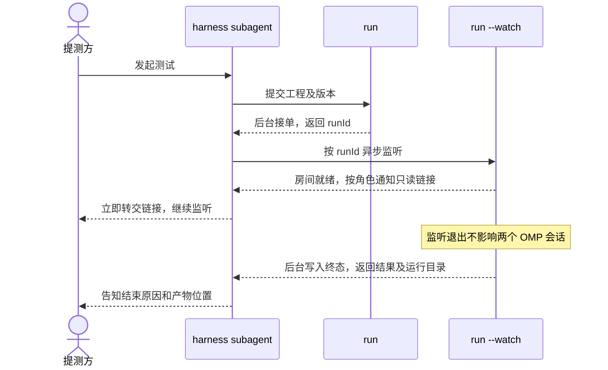

# 用两个 OMP 主会话测试一个 SKILL

`run` 做三件事：从指定提交准备隔离环境，启动负责人和被测 agent，在后台留下过程和产物。**提测方决定要看什么效果，框架不打分。** 两个角色是同一工作区里的独立 OMP 主会话；被测方可以使用工具，也可以派自己的 subagent。

## 1. 安装运行器

在本仓库根目录运行：

```sh
pkg=$(nix-build --no-out-link -E 'with import <nixpkgs> {}; callPackage ./agent-test {}')
export PATH="$pkg/bin:$PATH"
run --help
```

宿主需要 Linux（含 `/proc`）、Git、tar、可用的 `<nixpkgs>`，以及启用了 `nix-command` 和 `flakes` 的 Nix。提测工程的 flake 提供 OMP 和任务工具；不需要为框架额外安装 Python。验证版本：Nix 2.35.2、OMP 19.0.1。使用可信的工程、提示词和 SKILL：独立 HOME 和工作区是配置隔离，**不是安全沙箱**。

## 2. 准备提测工程

下面是一份**示例布局**，不是框架生成的模板。路径由根目录的 `test.nix` 指定。

```text
test-project/
├── flake.nix、flake.lock                 # 两个角色共用的工具环境
├── test.nix
├── owner.md                             # 负责人扮演谁、推进到哪里
├── roles/coordinator/config.yml         # 负责人的 OMP 配置
├── roles/subject/config.yml             # 被测角色的 OMP 配置
├── roles/subject/skills/<name>/SKILL.md  # 可选：角色默认 SKILL
└── scene/                               # 可选：给本次任务用的工程
```

`test.nix`：

```nix
{
  coordinator = { ompConfigDir = "roles/coordinator"; prompt = "owner.md"; };
  subject.ompConfigDir = "roles/subject";
  workspaceSource = "scene";  # 不需要初始工程时，删掉这行
}
```

把待测 SKILL 放在**一个**合适的位置即可：放进 `scene/` 里的工程 SKILL 目录，按 OMP 规则加载；或放在被测角色的 `skills/` 中。角色目录还可以有自己的 `models.yml`。负责人可有自己的默认 SKILL，互不代装。`owner.md` 不放进共享工作区，只把路径交给负责人。例如：“你是报修人。请报修走廊灯；对方询问时说明灯在闪烁。已派工不等于修好；等到对方确认修复再结束。如果缺少无法补充的材料，说明卡在哪里。”框架不预设下一句对话。

**工具环境。** 已有 flake 的工程，在 `devShells.<system>.default` 放入可工作的 OMP 包和任务所需工具即可。若先在本机试跑，且现有 OMP 来自 Nix store，可在 `test-project/` 使用下面的命令生成一个机器本地的 `flake.nix`。它把具体 OMP 版本写入文件，不继承宿主工具路径：

```sh
omp_bin=$(dirname "$(realpath "$(command -v omp)")")
system=$(nix-instantiate --eval --raw --expr builtins.currentSystem)
cat > flake.nix <<EOF
{
  inputs.nixpkgs.url = "path:$(nix-instantiate --find-file nixpkgs)";
  outputs = { nixpkgs, ... }: let pkgs = nixpkgs.legacyPackages.$system; in {
    devShells.$system.default = pkgs.mkShellNoCC {
      shellHook = ''export PATH=$omp_bin:\$PATH'';
    };
  };
}
EOF
```

这个便捷例子要求相应 store 路径在本机仍可用。要跨机器复现，应在 flake 中引用锁定的 OMP 包，把它列入 `packages`，不要提交某台机器的路径。

## 3. 配置模型与认证

每个角色都要有 `config.yml`。用 `omp models` 找到**已获授权**的确切 `provider/model` 名称。两个文件可选不同模型。下例中的模型名要替换：

```yaml
modelRoles:
  default: my-gateway/my-model
  # task: other-gateway/helper-model   # 仅在需要指定子任务模型时添加
task:
  crossInstance: true
tools:
  approvalMode: yolo                  # 仅用于可信材料、无需人工批准的试跑
```

角色显式声明的模型优先于工作区的同名设置。例如被测方配置了 `task`，工程不能悄悄换掉这个帮手模型；没配置的角色仍按 OMP 原生规则选择。框架关闭首次启动向导、错误后换模和上下文自动换模，但不会替角色批准工具操作。不要为无人值守的场景配置必须有人点击批准的步骤。

- **已有宿主 OMP 登录**：直接复用，包括 OAuth 登录。运行器按显式模型所需的 provider 取当前令牌，不复制宿主凭证库，不替用户续登录。已有登录失效时会报错，不偷偷换另一把 key。
- **只有 API key**：在宿主创建 `${XDG_CONFIG_HOME:-$HOME/.config}/agent-test/credentials.toml`，权限 `0600`。某个 provider 没有 OMP 登录时才用这里的值。两个角色需要同一家服务只配一次。

```toml
[providers]
my-gateway = "在本机填入密钥，不要提交"
```

自定义服务在**使用它的角色目录**配 OMP 原生 `models.yml`。这里的 `apiKey` 是**环境变量名**，不是密钥，也不是 shell 命令：

```yaml
providers:
  my-gateway:
    api: openai-completions
    baseUrl: https://your-provider.example/v1
    apiKey: MY_GATEWAY_KEY
    models:
      - { id: my-model, name: My model }
```

若使用 OMP 已认识的服务，不必为了认证专门提交 `models.yml`。运行器只向对应角色注入所需凭证；被测方的子任务也在被测角色的凭证范围内。不要把密钥放进 flake、Git、提示词或工程，不要让角色把自己的环境变量打印到会话中。

## 4. 提交并查看结果

先将需要参测的文件和锁文件提交到提测工程。新工程可在 `test-project/` 执行 `git init -b main`、`git add .`、`nix flake lock`、`git add flake.lock`、`git commit -m 'Prepare skill scenario'`。不要求推送或切换分支。运行器不从你的当前工作区补拷改动、暂存文件或未跟踪附件。若工程原有的检出步骤在选定提交的独立副本中生成了材料，生成物会随实际起点一起归档。

在希望保存结果的目录执行以下**一种**：

```sh
run /path/to/test-project                                # 当前 HEAD
run /path/to/test-project --branch main                  # 本地分支尖端
run /path/to/test-project --branch main --commit abc123  # 该分支历史中的提交
```

收到 `{"runId":"…","status":"submitted"}` 就可以做别的事。它表示后台已经接单，不表示模型已回复、认证已通过或 SKILL 有效。提交前的材料、凭证或环境错误直接写 stderr，退出码非零。

### 旁听和结束通知

默认开启测试负责人和被测方的 **OMP 只读旁听**，不需要改角色配置，也不替你打开浏览器。旁听使用 OMP 配置的中继；能拿到链接的人能看到该会话。材料不宜经中继传输时，提交用 `run /path/to/test-project --no-observe`。不要把链接贴到共享日志、工单或公共频道。

从**发起提交的目录**运行：

```sh
run --watch "$runId"   # 用提交返回的编号，不是 harness 的后台任务编号
```

这是一个只读监听命令。它逐行输出 JSON：每个房间就绪时发 `event: "view"`，带 `role`（`coordinator` 或 `subject`）和可直接打开的 `url`。结束时发 `event: "terminal"`，带停止原因和绝对路径 `runDir`。**运行目录就是产物**；框架不提取终稿，不判断 SKILL 效果。没有旁听链接不等于测试失败。

`terminal` 表示**读到了运行终态**，不是测试成功；看 `scene` 和 `reason` 区分正常完成、场景异常和运行故障。`unavailableViews` 只列这次监听没拿到链接的角色，不表示整场测试从未开过旁听。

**委派给 harness subagent 时**，可以直接这样交代：

> 提交这个测试，把运行编号告诉我。从同一个目录异步调用 `run --watch <编号>`，Bash 设 `timeout: 0`，`notify` 匹配 `"event":"view"`。每收到一个角色的只读链接，**立即发回父会话，不结束委派**。收到终态后，再回复结束原因和运行目录。不用反复调用命令查状态。

实时监听需要 Linux 的 `pidfd_open`（5.3+）和当前用户读取监督进程 `/proc/<pid>/fdinfo` 的权限；重看已经写入的终态不依赖活进程。

关掉监听不会停测。回来后用相同编号再次监听：还在跑就继续旁听，已经结束就返回终态，不重开房间。harness 重启不会自动恢复订阅。若没有终态、又不能确认监督进程仍在，监听命令报错，不把它当成正常完成。



不使用监听也可以直接查看**发起命令所在目录**的 `runs/<runId>/`，无需另起服务：

| 想知道什么 | 看哪里 |
| --- | --- |
| 测的是哪个版本、现在是否结束、为什么停 | `run.log`（逐行 JSON；`submitted` 有 commit 和开发环境 `.drv`，唯一 `terminal` 分开记录 `scene`、`reason`、`exits`、`cleanup` 和 `evidence`） |
| 两个角色实际说了什么、谁派了帮手 | `home/.omp/profiles/{coordinator,subject}/agent/` 各自的 OMP 原生会话 |
| 当时用了什么提示词和角色材料 | `coordinator-prompt.md` 和对应角色的 `agent/` |
| 工作区发生了什么变化 | `start.tar.gz` 是可选起点；`workspace/` 是最终现场，不另打结束包 |

`completed` 是负责人确认场景目标已达；`scenario_error` 是材料或场景无法再推进，原因在 `sceneReason`。`scene: null` 表示没有确认的场景报告，例如负责人失联、所需模型拒绝认证。有效报告和实际停止原因可以同时存在：负责人已报告完成、最后一轮卡住，仍保留 `completed`，另记 `exit_grace_timeout`。没有终态不能推断成功。凭证过期时重新登录宿主 OMP 或更新本机配置，再发起新的测试。

默认首次发现 120 秒、等待巡检 60 秒、负责人心跳 600 秒、运行上限 3600 秒、报告后退出宽限 30 秒。需调整时，在宿主 `agent-test/settings.toml`（和凭证配置同目录）用 `[timers]` 设置 `discovery`、`poll`、`heartbeat`、`total`、`grace`，单位是秒。长任务通常需要调大 `total`；长时间不返回的单个模型请求还要考虑 `heartbeat`。可向本次 `submitted.pid` 发送 `SIGTERM` 请求停止，留给运行器核对已有报告并回收两个角色。

即使从另一个 Git 工程里发起测试，OMP 也不应加载那个工程的 `AGENTS.md` 和 SKILL。运行根的私有 Git 边界只负责截断向上发现；它不跟踪会话或产物，不在 `workspace/` 中建仓库，也不参与判断测的是哪个提交。

工程内符号链接会原样保留；指向工程外的文件不会被复制或隔离。运行目录和会话可能包含敏感业务数据，不宜整包公开。

## 验证框架自身

从仓库根目录运行 `python3 -B -m unittest discover -s agent-test/tests -v`。需要本机 PATH 上有 Nix store 安装的 OMP。端到端验收从正式 `run` 提交真实 Git 工程，使用 Nix、两个真实 OMP 进程和原生会话；只用本地模型服务控制交付、401、挂起等分支。常规回归不使用真实账户或公共旁听中继，也不以这些脚本回复评判某个 SKILL 的效果。
