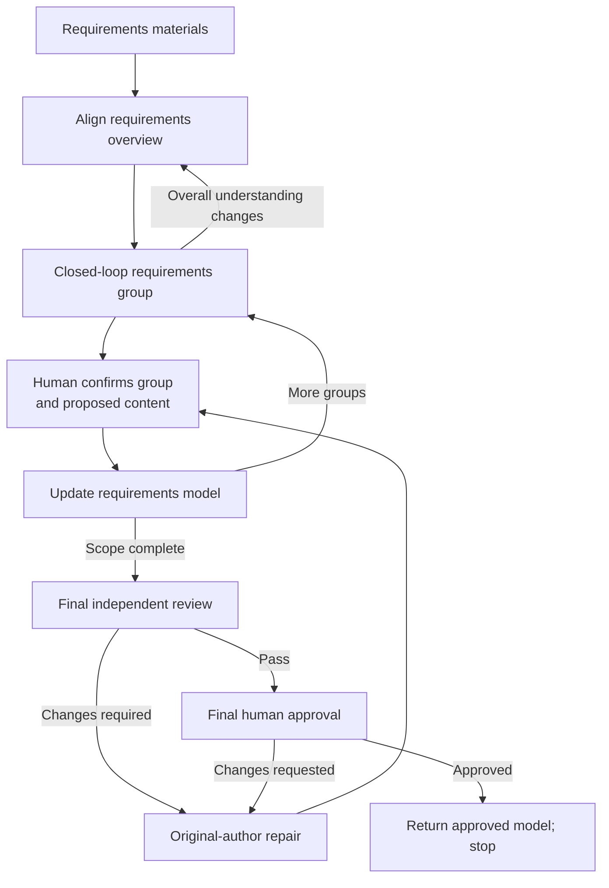

# Clarify Requirements

Clarify intended behavior and domain meaning with the human.
Produce a requirements model ready for subsequent design.
Stop at requirements approval.

Follow [REQUIREMENTS-MODEL.md](REQUIREMENTS-MODEL.md) as the authoring and review standard.

## Establish the basis

- Read the requirements materials supplied by the human: verbal descriptions, documents, examples and other provided sources.
- Inspect existing behavior when it affects the requirements. Recover missing or stale context only within the affected scope.
- Read the registered `progressive-modeling` skill and apply it within the assigned requirements scope.

## Clarification methods

### Brainstorming

When the direction is unclear, use the `brainstorming` skill to explore
it with the human. If the human asks to brainstorm, acknowledge what
you are exploring and begin. If you suggest it, explain why and wait
for agreement before switching.

### Draft-based iteration

Once there is a working draft, refine it with the human.

- Revise the requirements already presented in chat. Accumulate changes on that draft.
- Re-present the complete revised draft when appropriate, not only the changes.
- Present the complete final draft for human confirmation. Write that version into the model after confirmation.

**Example:**

```text
AI：当前草案包含 [A]、[B]、[C]。
用户：把 [B] 改成 [B′]。
AI：已在当前草案中把 [B] 换成 [B′]，[A] 和 [C] 不变。
用户：再补上 [D]。
AI：合并两次修改后的完整草案是：[A]、[B′]、[C]、[D]。可以按这版写入吗？
用户：可以。
AI：已按确认的版本写入。
```

### Scenarios and domain concepts

- Walk actors through triggers, starting states, actions and observable outcomes.
- Vary consequential boundaries and failure cases to expose business rules.
- Use consistent domain terms for distinctions that change rules or outcomes.
- Investigate accessible facts before asking the human.
- Resolve upstream business choices before their dependent details.

## Workflow



Adjust clarification depth to the supplied material. A sufficiently specified request needs no separate interview.

## Macro requirements: overview

Apply progressive modeling within the assigned scope.

- Clarify the problem, intended outcomes and business boundaries.
- Identify the main actors, core concepts and end-to-end business flow.
- Distinguish required changes from preserved behavior and exclusions.
- Use Mermaid views where they help explain the overall flow and relationships.

Retain imposed technical constraints when they affect requirements. Leave realization choices to subsequent design.

## Micro requirements

A closed-loop group is the unit of micro clarification. It covers a bounded business outcome across the relevant actors, concepts, rules and normal or exceptional paths.

Apply progressive modeling within each closed-loop group.

- Clarify triggering conditions, business rules, state changes, outcomes and consequential exceptions with the human.
- Capture the reasons behind consequential business choices.
- Add labeled **Acceptance criteria** beside the behavior they verify.
- Assess when to present the complete group again, including its scenarios, rules, views and acceptance criteria.

**Confirmation unit:** Confirm the whole group, not individual rules or exceptions.

Revisit the macro requirements model when group clarification changes the overall understanding. Reconcile affected groups before advancing to dependent requirements.

## Write confirmed model content

Integrate confirmed overviews and groups as clarification progresses.

- Carry their diagrams, tables, scenarios, rules, acceptance criteria and essential explanations into the model. Do not replace them with prose summaries.
- Show the exact content and destination in the main response. Obtain human confirmation before writing.
- Reconfirm changed content before writing.
- Integrate refinements into their owning sections and update affected views, rather than accumulating interview history.

Keep unconfirmed proposals in conversation, not candidate files.

## Final review

- Submit the complete current model, its sources and confirmation evidence to an independent review subagent using [reviewer-prompt.md](reviewer-prompt.md).
- The original author repairs findings. Ask the original reviewer if findings are unclear. The same reviewer reassesses.
- Obtain final human approval after Pass.

## Return and stop

- Return the approved model/source references and the review and approval results.
- Stop before architecture, technical design or implementation. Do not automatically start the next stage.
