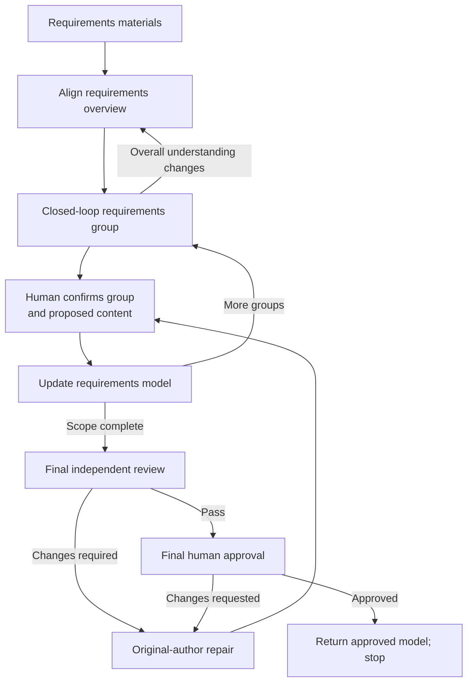

# Clarify Requirements

Clarify intended behavior and domain meaning with the human.
Produce a requirements model ready for subsequent design.
Stop at requirements approval.

Follow [REQUIREMENTS-MODEL.md](REQUIREMENTS-MODEL.md) as the authoring and review standard.

## Establish the basis

- Read the requirements materials supplied by the human: verbal descriptions, documents, examples and other provided sources.
- Inspect existing behavior when it affects the requirements. Recover missing or stale context only within the affected scope.
- Use the `artifact-layout` skill for documents produced by this skill: file locations, directory layout and writing boundaries.
- Use the `communication-style` skill for human communication.

For heavyweight children:
- Read the applicable root requirements and assigned clarification scope.
- Inherit shared domain meanings, business rules and clarification dependencies.
- Return cross-scope conflicts or changes to shared rules to the root owner.
- Update assigned requirements documents. Propose root document updates to the root owner.

## Clarification methods

### Draft-based iteration

Apply this method throughout requirements clarification.

- Revise the requirements already presented in chat. Accumulate changes on that draft.
- Re-present the complete revised draft when appropriate, not only the changes.
- Present the complete final draft for human confirmation. Write that version into the model after confirmation.

**Example:**

```text
AI：
创建 GitHub issue 的需求草稿：
1. 整理标题与正文。
2. 发布到指定仓库。
3. 返回创建后的 issue 链接。

用户：
发布前，我需要先确认正文。

AI：
在当前草稿的发布步骤前，增加“展示正文并取得确认”，其他内容保留。

用户：
标题也一起确认。

AI：
合并两次修改，完整需求更新为：
1. 整理标题与正文。
2. 向用户展示标题和正文，取得确认。
3. 将确认的内容发布到指定仓库。
4. 返回创建后的 issue 链接。

是否将这份完整需求写入需求模型？

用户：
可以。

AI：
按上面确认的完整版本写入需求模型。
```

### Scenarios and domain concepts

- Walk actors through triggers, starting states, actions and observable outcomes.
- Vary consequential boundaries and failure cases to expose business rules.
- Use consistent domain terms for distinctions that change rules or outcomes.
- Investigate accessible facts before asking the human.
- Resolve upstream business choices before their dependent details.

## Workflow



Adjust clarification depth to the supplied material. A sufficiently specified request needs no separate interview.

## Requirements overview

Establish the overall business understanding within the assigned scope.

- Clarify the problem, intended outcomes and business boundaries.
- Identify the main actors, core concepts and end-to-end business flow.
- Distinguish required changes from preserved behavior and exclusions.
- Use Mermaid views where they help explain the overall flow and relationships.

Retain imposed technical constraints when they affect requirements. Leave realization choices to subsequent design.

## Detailed requirements: closed-loop groups

Turn the overview into business behaviors with clear rules, observable results and acceptance criteria.

A group covers a bounded business outcome across the relevant actors, concepts, rules and normal or exceptional paths.

- Clarify triggering conditions, business rules, state changes, outcomes and consequential exceptions with the human.
- Capture the reasons behind consequential business choices.
- Add labeled **Acceptance criteria** beside the behavior they verify.
- Assess when to present the complete group again, including its scenarios, rules, views and acceptance criteria.

**Confirmation unit:** The whole group, not individual fields, rules or exceptions.

Revisit the overview when group clarification changes the overall understanding. Reconcile affected groups before advancing to dependent requirements.

## Update the requirements model

Integrate confirmed overviews and groups as clarification progresses.

- Carry their diagrams, tables, scenarios, rules, acceptance criteria and essential explanations into the model. Do not replace them with prose summaries.
- Show the exact content and destination in the main response. Obtain human confirmation before writing.
- Reconfirm changed content before writing.
- Integrate refinements into their owning sections and update affected views, rather than accumulating interview history.

Root models retain shared meanings and end-to-end flows; child models retain scoped detail.

Keep unconfirmed proposals in conversation, not candidate files.

## Final review

- Submit the complete current model or requirements package, its sources and confirmation evidence to an independent review subagent using [reviewer-prompt.md](reviewer-prompt.md).
- The original author repairs findings. Ask the original reviewer if findings are unclear. The same reviewer reassesses.
- Obtain final human approval after Pass.

## Return and stop

- Return the approved model/source references and the review and approval results.
- Heavyweight children return to the root. The complete requirements package needs approval before architecture.
- Stop before architecture, technical design, ticketing or implementation. Do not automatically start the next stage.
