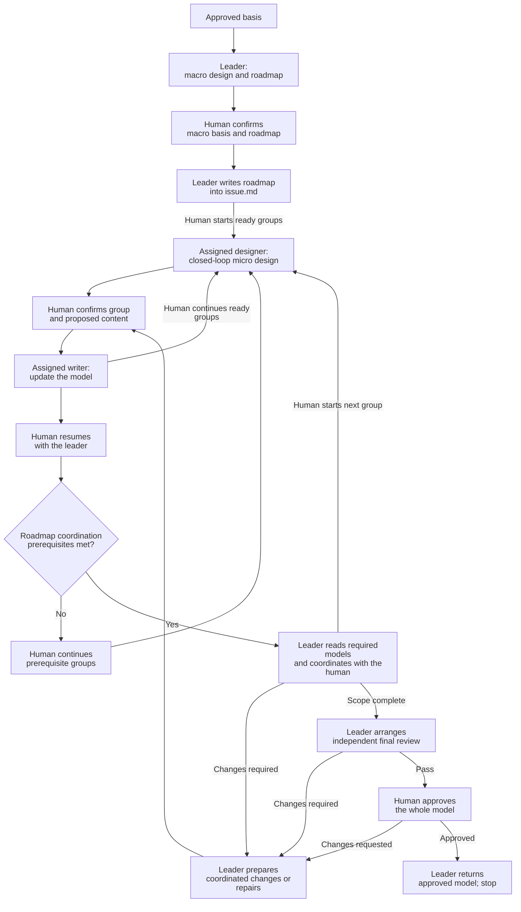

# Clarify Technical Design

Co-design the technical realization with the human, from macro to micro.
Follow [TECHNICAL-MODEL.md](TECHNICAL-MODEL.md) as the authoring and review standard.

## Roles and collaboration

Identify your role from the current task or assignment.
Follow the corresponding workflow and resume at its current step.
Reading this skill does not expand your role or authority.

Macro and micro are relative to the assigned scope.
Keep confirmed upstream decisions as constraints.

### Leader

The human initiates cross-group coordination and progression.

1. **Plan with the human.**
   Establish the basis and clarify the macro direction.
   Divide the scope into closed-loop design groups.

   Create a **Design Alignment Roadmap**: a dependency graph of these groups.
   Edges point from prerequisite groups to dependent groups.
   Each dependency identifies the upstream design needed by the downstream group.
   Mark coordination points and the group designs required at each point.

   Confirm the macro direction and roadmap with the human.
   Write the confirmed roadmap into the workspace's `issue.md`.

2. **Assign groups along the roadmap.**
   At the human's request, assign ready groups or design them yourself.
   Follow the roadmap in `issue.md`.
   Independent groups may progress concurrently.
   Start dependent groups from confirmed upstream models, after resolving their blockers.

   Create each closed-loop designer as a separate AI agent with its own human-facing conversation.
   The human must be able to open that conversation and talk to the agent directly.
   Disable automatic notifications from designers to the leader.

   Each assignment includes:
   - The designer role, behavior boundary and assigned files.
   - Governing decisions, roadmap dependencies and confirmed upstream models.

   Give the designer write access to its assigned files.
   Require reading `clarify-technical-design` in full and its `TECHNICAL-MODEL.md` before starting.

3. **Coordinate along the roadmap.**
   At the human's request, check which coordination points are ready.
   Use the Design Alignment Roadmap to identify the required group designs.
   Once those designs are complete, confirmed and written, read them together.
   Clarify their conflicts and coupling directly with the human.

   Take over revisions to the affected model files.
   Follow **Update the model** without routing changes back through designers.

   Identify which downstream groups are ready for further alignment.
   If dependencies change, confirm the revised roadmap with the human and update `issue.md`.

4. **Complete the whole-model review.**
   Run **Final review**, obtain final human approval, then **Return and stop**.

### Closed-loop designer

A closed-loop designer is a human-facing AI agent.
Make design decisions for your assigned behavior directly with the human.

1. Establish the group's basis from the assignment and confirmed upstream decisions.
2. Apply **Clarification methods** and **Micro design** within that scope. Use **Macro design** within that scope when needed.
3. Obtain human confirmation. Follow **Update the model** for your assigned files.

Keep tentative design choices within the group's clarification.
The human initiates coordination with the leader after local completion.
No completion report to the leader is required.
Local completion does not approve the whole model.

### Scouts

Scouts explain existing code and documents. They do not make task decisions.
They use `collaboration-guidance` and `communication-style`.

The leader and each designer create and reuse their own scouts.

## Establish the basis

- Read approved requirements, original context and prior decisions/approvals.
- Inspect the relevant repository baseline. Recover missing or stale design context only within the affected scope.
- Use the `artifact-layout` skill for documents produced by this skill: file locations, directory layout and writing boundaries.
- Use the `communication-style` skill for human communication.
- Use the `collaboration-guidance` skill for reusable scouts.
- Resolve cross-skill resources through registered owners. Reading a standard does not start its workflow.

For heavyweight children:
- Read the approved root requirements and architecture.
- Inherit guarantees, boundary contracts, shared-owner assignments and child dependencies.
- Return global conflicts to the owning authority.
- Update assigned realizations. Return root navigation changes to the root owner.

## Clarification methods

### Draft-based iteration

Apply this method throughout macro and micro clarification.

- Revise the proposal already presented in chat. Accumulate changes on that draft.
- Re-present the complete revised proposal when appropriate, not only the changes.
- Present the complete final proposal for human confirmation. Write that version into the model after confirmation.

**Example:**

```text
AI：
单任务实现流程如下：

1. 使用 tdd 实现，完成验证。
2. 委派独立子 agent，使用 code-review 评审。
3. 有问题则修复、验证，交回原评审子 agent；重复直到 Pass。
4. 返回完成结果。

用户：
送审前，先把本次改动提交一次 commit。

AI：
在当前方案的“完成验证”和“委派评审”之间加入 commit，其他内容保留。

用户：
每轮评审之后的修复也要提交，方便留痕。

AI：
合并这两次修改，完整方案更新为：

1. 使用 tdd 实现，完成验证。
2. 提交本任务的改动。
3. 委派独立子 agent，使用 code-review 评审。
4. 有问题则修复、验证，提交本轮改动，再交回原评审子 agent；重复直到 Pass。
5. 返回完成结果。

这份完整方案是否可以写入 implement/SKILL.md？

用户：
可以。

AI：
按上面确认的完整版本写入。
```

## Workflow

The diagram shows the leader's whole-stage route.

For multi-designer work, read [Collaboration flow](collaboration-flow.md).
It shows direct human clarification, human-led progression and dependency-based coordination.



Module decomposition may lead to multiple macro-to-micro cycles.
Integrate confirmed macro and micro groups as the design progresses.
Reconfirm a changed macro basis before dependent micro design.

## Macro design

Clarify the technical direction within your scope with the human.

Use your own scouts from this stage; begin their preparation once likely investigation scopes are known, following `collaboration-guidance`.

Settle topology, responsibility boundaries and technical direction.

- When code conflicts with established decision documents, prioritize the documented decisions.
- Trace required scenarios through owners, state and core interactions.
- Compare reuse with necessary changes.
- Confirm the macro basis before dependent micro design.

### Macro views

- Use Mermaid topology and sequences to present macro collaboration.
- Add a separate data-flow view when needed for clarity.

## Micro design: closed-loop groups

Turn the confirmed macro design into implementation-ready definitions, contracts and collaboration flows.

A group covers a complete bounded behavior across collaborating owners, definitions, operations and flows.

- Use confirmed macro decisions as the technical direction for the group’s micro proposal.
- Clarify changes, data structures, interfaces and exception cases with the human.
- Assess when to present the complete group again. Include topology/sequences, data definitions and interface contracts.
- Consider data definitions and sequences together. Choose the starting point based on the design problem.

**Confirmation unit:** The whole group, not individual fields, types, interfaces or files.
Confirm the group and reconcile affected views before advancing to dependent design.

- Present complete data definitions, including internal types, and interface declarations in fenced code blocks.
- Use Mermaid topology and sequences to explain the group’s collaboration.

## Update the model

Integrate complete confirmed proposals as the design progresses.

### Organize canonical content

Use one `technical.md` for simple scopes.
Use linked `technical/<group>.md` parts when groups need separate writers. Follow `artifact-layout`.
These files form one model. Name parts by design scope, not agent identity.

For a split model, workspace file responsibilities are:

| File | Responsibility | Writer | References |
| --- | --- | --- | --- |
| `issue.md` | Work definition, navigation and the confirmed Design Alignment Roadmap | Leader | Link design groups to their model files. |
| `technical.md` | Global direction, boundaries and cross-group relationships; navigation; complete file-responsibility tree; integrated test plan | Leader | Reference group contracts to explain whole-model behavior. |
| `technical/<group>.md` | Complete scoped design: definitions, operations, data/state flows, interactions, exceptions and boundaries | Assigned designer during local clarification; leader during coordination and whole-model repairs | Reference global constraints and contracts owned by other parts. |

Place shared definitions and contracts in the file responsible for that design.

Define shared contracts once. Other parts reference their canonical location.
Apply `TECHNICAL-MODEL.md` across the complete model.
Local parts supply concrete detail and canonical references, without repeating global sections.

### Write confirmed content

- Designers write their assigned files during local clarification.
- When the human starts coordination of completed groups, the leader takes over revisions to their model files. Those designers stop writing them.
- Keep one active writer per file.
- Preserve unaffected confirmed content without routinely reconfirming unchanged decisions.

- Carry their diagrams, tables, code and essential explanations into the model. Do not replace them with prose summaries.
- Show the exact content and destination in the current writer's conversation with the human. Obtain human confirmation before writing.
- Integrate confirmed content into canonical sections. Reconcile affected decisions and references.

Keep unconfirmed proposals in conversation, not candidate files.

The leader arranges direct human contact for each assigned designer.

## Final review

The leader organizes this whole-model stage and repairs findings across the complete model.

- Submit the complete model, including all linked parts, sources and evidence to an independent reviewer using [reviewer-prompt.md](reviewer-prompt.md).
- The same reviewer reassesses after repairs.
- Obtain final human approval after Pass.

Ask the original reviewer if feedback is unclear.

Changed content still requires human confirmation before writing.
The same reviewer reassesses the affected complete model before final approval.

## Return and stop

The leader returns the whole-stage result.

- Return approved model/source references, the review result, human approval and evidence references.
- Heavyweight children return to the root. All scoped realizations must be complete and approved before root-controlled implementation and one delivery.
- Stop before coding. Do not automatically start the next stage.
