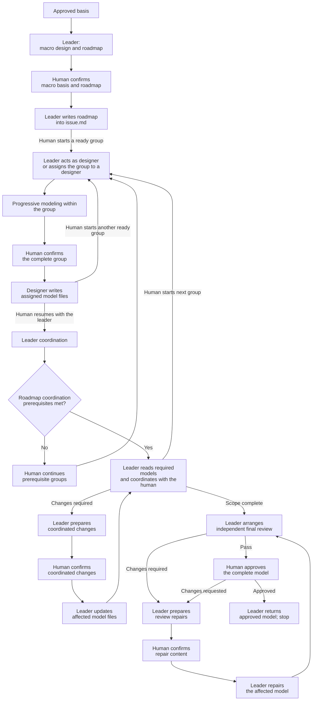

# Clarify Technical Design

Co-design the technical realization with the human, from macro to micro.
Follow [TECHNICAL-MODEL.md](TECHNICAL-MODEL.md) as the authoring and review standard.

## Establish the basis

- Read approved requirements, original context and prior decisions/approvals.
- Read the registered `progressive-modeling` skill and apply it within the assigned design scope.
- Inspect the relevant repository baseline. Recover missing or stale design context only within the affected scope.
- Use the `artifact-layout` skill for documents produced by this skill: file locations, directory layout and writing boundaries.
- Use the `collaboration-guidance` skill for reusable scouts.
- Resolve cross-skill resources through registered owners. Reading a standard does not start its workflow.

## Clarification methods

### Draft-based iteration

Apply this method throughout macro and micro clarification.

- Revise the proposal already presented in chat. Accumulate changes on that draft.
- Re-present the complete revised proposal when appropriate, not only the changes.
- Present the complete final proposal for human confirmation. Write that version into the model after confirmation.

**Example:**

```text
AI：
单任务实现流程如下：

1. 使用 tdd 实现，完成验证。
2. 委派独立子 agent，使用 code-review 评审。
3. 有问题则修复、验证，交回原评审子 agent；重复直到 Pass。
4. 返回完成结果。

用户：
送审前，先把本次改动提交一次 commit。

AI：
在当前方案的“完成验证”和“委派评审”之间加入 commit，其他内容保留。

用户：
每轮评审之后的修复也要提交，方便留痕。

AI：
合并这两次修改，完整方案更新为：

1. 使用 tdd 实现，完成验证。
2. 提交本任务的改动。
3. 委派独立子 agent，使用 code-review 评审。
4. 有问题则修复、验证，提交本轮改动，再交回原评审子 agent；重复直到 Pass。
5. 返回完成结果。

这份完整方案是否可以写入 implement/SKILL.md？

用户：
可以。

AI：
按上面确认的完整版本写入。
```

## Workflow

The diagram shows the leader's whole-stage route.

For multi-designer work, see the [collaboration example](roles-and-collaboration.md#multi-designer-collaboration).
It shows direct human clarification, human-led progression and dependency-based coordination.



Apply progressive modeling within each design scope. Module decomposition may lead to multiple macro-to-micro cycles.
Integrate confirmed macro and micro groups as the design progresses.
Reconfirm a changed macro basis before dependent micro design.

## Macro design

Apply progressive modeling within this scope. Establish a working macro model before advancing dependent design.

Use your own scouts from this stage; begin their preparation once likely investigation scopes are known, following `collaboration-guidance`.

Clarify the technical direction within this scope with the human.

Settle:

- Topology and responsibility boundaries.
- State ownership and core data flow.
- Required scenarios and cross-boundary collaboration.
- Reuse and necessary changes.
- Dependencies on other design groups.

Trace required scenarios through owners, state and core interactions.

Determine which technologies to use based on the requirements and technical direction.

Use the applicable sections of
[TECHNICAL-MODEL.md](TECHNICAL-MODEL.md) as clarification prompts, especially
[Macro runtime and collaboration model](TECHNICAL-MODEL.md#macro-runtime-and-collaboration-model).

Confirm the macro basis before dependent design.

## Micro design

A closed-loop group is the unit of micro clarification. It covers a complete bounded behavior across collaborating owners, definitions, operations and flows.

**Confirmation unit:** Confirm the whole group, not individual fields, types, interfaces or files.

Apply progressive modeling within the group. Turn the current macro model into implementation-ready definitions, contracts and collaboration flows.

- Use the current macro model as the technical direction for the group’s micro proposal.
- Clarify changes, data structures, interfaces and exception cases with the human.
- Consider data definitions and sequences together. Choose the starting point based on the design problem.

During clarification, use the applicable sections of
[TECHNICAL-MODEL.md](TECHNICAL-MODEL.md) as prompts, especially:

- [Micro object and collaboration model](TECHNICAL-MODEL.md#micro-object-and-collaboration-model)
- [Complete data-structure definitions](TECHNICAL-MODEL.md#complete-data-structure-definitions)
- [Complete interface contracts](TECHNICAL-MODEL.md#complete-interface-contracts)

## Document organization

Use one `technical.md` for simple scopes.
Use linked `technical/<group>.md` parts when groups need separate writers. Follow `artifact-layout`.
These files form one model. Name parts by design scope, not agent identity.

For a split model, workspace file responsibilities are:

| File | Responsibility | References |
| --- | --- | --- |
| `issue.md` | Work definition, navigation and the confirmed Design Alignment Roadmap | Link design groups to their model files. |
| `technical.md` | Global direction, boundaries and cross-group relationships; navigation; complete file-responsibility tree; overall integration test plan | Reference group contracts to explain whole-model behavior. |
| `technical/<group>.md` | Complete scoped design: definitions, operations, data/state flows, interactions, exceptions and boundaries; internal test plan | Reference global constraints and contracts owned by other parts. |

Place shared definitions and contracts in the file responsible for that design.

Define shared contracts once. Other parts reference their canonical location.
Apply `TECHNICAL-MODEL.md` across the complete model.
Local parts supply concrete detail and canonical references, without repeating global sections.

## Write confirmed model content

Keep unconfirmed proposals in the conversation, not model files.

Before writing, show the exact confirmed content and its destination to the human.

Write only confirmed content into canonical sections. Preserve its concrete diagrams, tables, declarations and essential rationale; do not replace them with summaries.

Reconcile affected decisions and references while preserving unaffected confirmed content.

## Final review

The leader organizes this whole-model stage and repairs findings across the complete model.

- Submit the complete model, including all linked parts, sources and evidence to an independent reviewer using [reviewer-prompt.md](reviewer-prompt.md).
- The same reviewer reassesses after repairs.
- Obtain final human approval after Pass.

Ask the original reviewer if feedback is unclear.

Changed content still requires human confirmation before writing.
The same reviewer reassesses the affected complete model before final approval.

## Return and stop

The leader returns the whole-stage result.

- Return approved model/source references, the review result, human approval and evidence references.
- Stop before coding. Do not automatically start the next stage.
