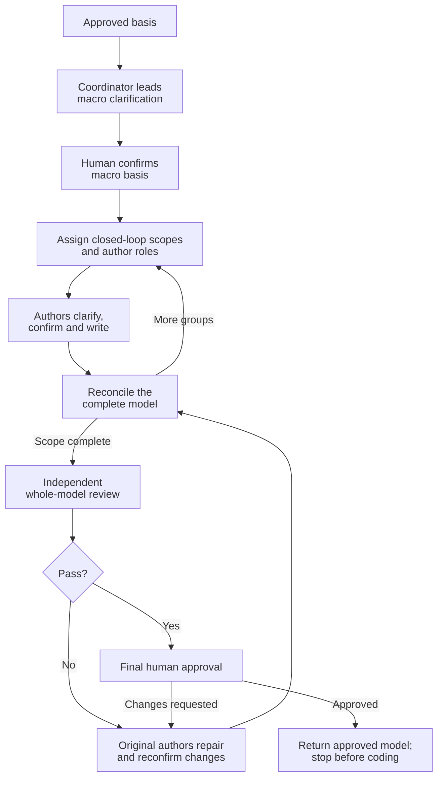

# Clarify Technical Design

Coordinate the complete technical design with the human. Follow [TECHNICAL-MODEL.md](TECHNICAL-MODEL.md) as the common authoring and review standard.

Use `artifact-layout` for document locations and writing boundaries, `communication-style` for human communication, and `collaboration-guidance` for reusable survey collaborators and decision-conflict escalation. Resolve cross-skill resources through registered owners; reading a standard does not start its owner's workflow.

## Establish the basis

Read approved requirements, original context, current models and prior decisions/approvals. Continue confirmed work within its still-valid basis rather than restarting it.

For heavyweight children:
- Read the approved root requirements and architecture.
- Inherit guarantees, boundary contracts, shared-owner assignments and child dependencies.
- Return global conflicts to the owning authority.
- Update assigned realizations. Return root navigation changes to the root owner.

## Roles and assignments

- **Coordinator:** leads overall macro alignment, assigns closed-loop scopes, reconciles dependencies and organizes whole-model review and final approval.
- **Design author:** the decision-maker for an assigned scope; uses `technical-design-author` to clarify with the human, write confirmed canonical content and repair findings. That role uses `technical-clarification` for the mature clarification method.
- **Survey collaborator:** uses `collaboration-guidance` and `communication-style` to explain existing code and documents. Shared by the coordinator and design authors; does not make task decisions.

Choose agent contexts that support their roles' communication and writing duties. In particular, shared survey collaborators must be able to receive questions and reply directly to their consumers.

The coordinator also uses `technical-design-author` when authoring the shared macro model or retaining a group's design work. Delegate where scopes can progress independently; multiple authors are not a prerequisite.

## Workflow

## Macro alignment and survey preparation

Use survey collaborators during macro alignment to establish relevant repository facts. Once likely investigation scopes are known, start their preparation while continuing macro clarification, following `collaboration-guidance`.

Keep the current goal's shared survey identities, scopes and contact routes known to the team. Include them when assigning authors and communicate later changes to affected members; a harness roster alone does not establish this role or goal membership.

Use `technical-clarification` to settle topology, responsibility boundaries and technical direction with the human. Confirm the macro basis before dependent micro design. Reconfirm a changed macro basis before dependent micro design.

## Assign closed-loop design

Divide the confirmed macro design into complete bounded behaviors, not merely code modules. Give each delegated group a decision-maker and the `technical-design-author` skill, with:

- Applicable requirements, confirmed macro decisions, scope, dependencies and peer contacts.
- Existing shared survey collaborators and their investigation scopes/contact routes.
- Canonical output files and their writers, plus the human contact and review routes.

Follow `artifact-layout`'s one-writer-per-file rule. Where authors work in parallel, assign canonical `technical/<group>.md` parts and link them from the coordinating `technical.md`; the model includes those parts, not summaries replacing them. Keep each shared contract authoritative in one place. The writer of a shared file integrates agreed changes proposed by its consumers.

Make the human contact route explicit. Use direct author conversations where available; otherwise relay the author's complete proposal and questions, then the human's reply, without taking over authorship or granting approval yourself.

## Reconcile the design

Track coverage, dependencies and shared contracts as authors return confirmed canonical content. Reconcile the complete model without re-deriving every local design or routinely asking the human to confirm unchanged local decisions again.

Use the decision-conflict escalation method in `collaboration-guidance` for incompatible peer choices or shared questions outside individual scope. The coordinator is the parent for its authors; it can appoint a peer to lead the shared question or lead directly. Keep unaffected scopes with their authors. Changed premises or confirmed content require renewed human confirmation before affected design or writes.

## Review, approve and return

Submit the complete model, including every linked design part, sources, confirmations and evidence to an independent reviewer using [reviewer-prompt.md](reviewer-prompt.md).

The original author repairs findings. The same reviewer reassesses. Ask the original reviewer if feedback is unclear. Route scoped repairs to their authors; cross-scope repairs use the same coordination and confirmation rules. The reviewer reassesses the complete affected model, not just isolated repaired fragments.

Obtain final human approval after Pass. Human changes return to the responsible authors, with confirmation before writes and reassessment by the same reviewer.

Return approved model/source references, the review result, human approval and evidence references.
Heavyweight children return to the root. All scoped realizations must be complete and approved before root-controlled implementation and one delivery.
Stop before coding. Do not automatically start the next stage.
