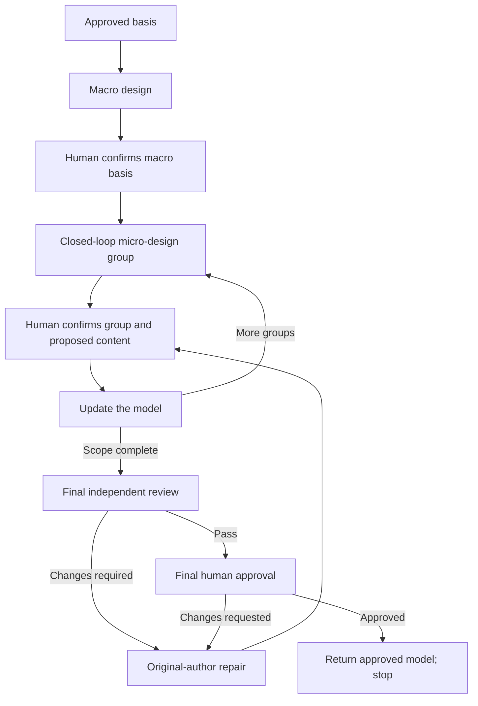

# Clarify Technical Design

Co-design the technical realization with the human, from macro to micro.
Follow [TECHNICAL-MODEL.md](TECHNICAL-MODEL.md) as the authoring and review standard.

## Establish the basis

- Read approved requirements, original context and prior decisions/approvals.
- Inspect the relevant repository baseline.
- Use `artifact-layout` for storage and ownership.
- Use `communication-style` for human communication.
- Resolve cross-skill resources through registered owners. Reading a standard does not start its workflow.

For heavyweight children:
- Read the approved root requirements and architecture.
- Inherit guarantees, boundary contracts, shared-owner assignments and child dependencies.
- Return global conflicts to the owning authority.
- Update assigned realizations. Return root navigation changes to the root owner.

## Workflow

Module decomposition may lead to multiple macro-to-micro cycles.
Integrate confirmed macro and micro groups as the design progresses.
Reconfirm a changed macro basis before dependent micro design.

## Macro design

Settle topology, responsibility boundaries and technical direction.

- When code conflicts with established decision documents, prioritize the documented decisions.
- Trace required scenarios through owners, state and core interactions.
- Compare reuse with necessary changes.
- Confirm the macro basis before dependent micro design.

## Micro design: closed-loop groups

Turn the confirmed macro design into implementation-ready definitions, contracts and collaboration flows.

A group covers a complete bounded behavior across collaborating owners, definitions, operations and flows.

- Use confirmed macro decisions as the technical direction for the group’s micro proposal.
- Clarify changes, data structures, interfaces and exception cases with the human.
- Assess when to present the complete group again. Include topology/sequences, data definitions and interface contracts.
- Consider data definitions and sequences together. Choose the starting point based on the design problem.

**Confirmation unit:** The whole group, not individual fields, types, interfaces or files.
Confirm the group and reconcile affected views before advancing to dependent design.

## Update the model

Update confirmed macro and micro decisions as the design progresses.

- Show the exact content and destination in the main response. Obtain human confirmation before writing.
- Integrate confirmed content into canonical sections. Reconcile affected decisions and references.

Keep unconfirmed proposals in conversation, not candidate files.

## Final review

- Submit the complete model, sources and evidence to an independent reviewer using [reviewer-prompt.md](reviewer-prompt.md).
- The original author repairs findings. The same reviewer reassesses.
- Obtain final human approval after Pass.

Use `review-records` for review and approval evidence.

## Return and stop

- Return approved model/source references and review/approval evidence.
- Heavyweight children return to the root. All scoped realizations must be complete and approved before one root ticket set, controller and delivery.
- Stop before ticketing or coding. Do not automatically start the next stage.
