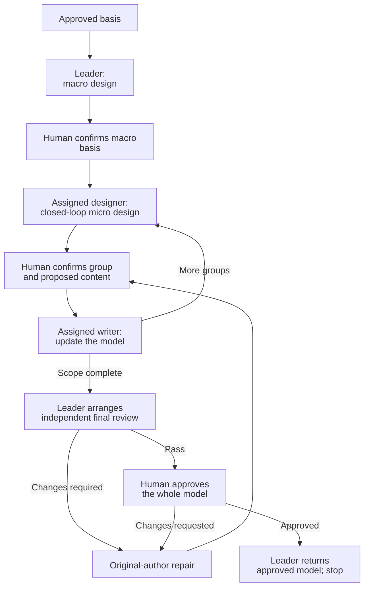

# Clarify Technical Design

Co-design the technical realization with the human, from macro to micro.
Follow [TECHNICAL-MODEL.md](TECHNICAL-MODEL.md) as the authoring and review standard.

## Establish the basis

- Read approved requirements, original context and prior decisions/approvals.
- Inspect the relevant repository baseline. Recover missing or stale design context only within the affected scope.
- Use the `artifact-layout` skill for documents produced by this skill: file locations, directory layout and writing boundaries.
- Use the `communication-style` skill for human communication.
- Use the `collaboration-guidance` skill for reusable survey collaborators and decision-conflict escalation.
- Resolve cross-skill resources through registered owners. Reading a standard does not start its workflow.

For heavyweight children:
- Read the approved root requirements and architecture.
- Inherit guarantees, boundary contracts, shared-owner assignments and child dependencies.
- Return global conflicts to the owning authority.
- Update assigned realizations. Return root navigation changes to the root owner.

## Roles and collaboration

- **Leader:** leads overall macro clarification, assigns closed-loop design scopes, coordinates dependencies and organizes whole-model review and final human approval.
- **Closed-loop designer:** the decision-maker for an assigned bounded behavior. Clarifies the design with the human, writes confirmed content into its assigned model files and repairs findings.
- **Survey collaborator:** explains existing code and documents using `collaboration-guidance` and `communication-style`. Shared by the leader and closed-loop designers; does not make task decisions.

The leader may also design closed-loop groups. Use the same clarification methods within each assigned scope; macro and micro are relative to that scope, subject to confirmed upstream decisions. Assign roles to agent contexts that support their communication and writing duties.

Keep survey collaborators' identities, investigation scopes and contact routes known to the team. Provide the existing contacts when assigning designers, and communicate changes to affected members. Designers consult those collaborators directly rather than recreate an existing investigation.

Use the decision-conflict escalation method in `collaboration-guidance` for incompatible peer choices or shared questions outside individual scope. The leader is the parent agent for its assigned designers. Keep unaffected work with its designers; an expanded decision scope does not transfer another file's writing responsibility.

## Clarification methods

### Draft-based iteration

Apply this method throughout macro and micro clarification.

- Revise the proposal already presented in chat. Accumulate changes on that draft.
- Re-present the complete revised proposal when appropriate, not only the changes.
- Present the complete final proposal for human confirmation. Write that version into the model after confirmation.

**Example:**

```text
AI：
单任务实现流程如下：

1. 使用 tdd 实现，完成验证。
2. 委派独立子 agent，使用 code-review 评审。
3. 有问题则修复、验证，交回原评审子 agent；重复直到 Pass。
4. 返回完成结果。

用户：
送审前，先把本次改动提交一次 commit。

AI：
在当前方案的“完成验证”和“委派评审”之间加入 commit，其他内容保留。

用户：
每轮评审之后的修复也要提交，方便留痕。

AI：
合并这两次修改，完整方案更新为：

1. 使用 tdd 实现，完成验证。
2. 提交本任务的改动。
3. 委派独立子 agent，使用 code-review 评审。
4. 有问题则修复、验证，提交本轮改动，再交回原评审子 agent；重复直到 Pass。
5. 返回完成结果。

这份完整方案是否可以写入 implement/SKILL.md？

用户：
可以。

AI：
按上面确认的完整版本写入。
```

## Workflow

The leader runs the whole-scope workflow. Closed-loop designers apply the methods and writing rules to their assigned groups, then return canonical content, confirmation references and cross-group effects to the leader. Local completion does not constitute whole-model review or approval.



Module decomposition may lead to multiple macro-to-micro cycles.
Integrate confirmed macro and micro groups as the design progresses.
Reconfirm a changed macro basis before dependent micro design.

## Macro design

The leader clarifies the overall technical direction with the human. Use shared survey collaborators from this stage; begin their preparation once likely investigation scopes are known, following `collaboration-guidance`.

Settle topology, responsibility boundaries and technical direction.

- When code conflicts with established decision documents, prioritize the documented decisions.
- Trace required scenarios through owners, state and core interactions.
- Compare reuse with necessary changes.
- Confirm the macro basis before dependent micro design.

### Macro views

- Use Mermaid topology and sequences to present macro collaboration.
- Add a separate data-flow view when needed for clarity.

## Micro design: closed-loop groups

Turn the confirmed macro design into implementation-ready definitions, contracts and collaboration flows.

A group covers a complete bounded behavior across collaborating owners, definitions, operations and flows.

The leader assigns closed-loop groups from the confirmed macro design. Each assignment identifies the governing decisions, behavior boundary, dependencies, relevant peers, shared survey contacts, model-writing responsibility and human contact route.

The assigned designer applies this skill within that scope. Independently ready groups may progress concurrently; dependent design follows the existing confirmation requirements.

- Use confirmed macro decisions as the technical direction for the group’s micro proposal.
- Clarify changes, data structures, interfaces and exception cases with the human.
- Assess when to present the complete group again. Include topology/sequences, data definitions and interface contracts.
- Consider data definitions and sequences together. Choose the starting point based on the design problem.

**Confirmation unit:** The whole group, not individual fields, types, interfaces or files.
Confirm the group and reconcile affected views before advancing to dependent design.

- Present complete data definitions, including internal types, and interface declarations in fenced code blocks.
- Use Mermaid topology and sequences to explain the group’s collaboration.

## Update the model

Integrate complete confirmed proposals as the design progresses.

Simple scopes may use one `technical.md`. When groups need separate writing responsibility, use linked `technical/<group>.md` parts as defined by `artifact-layout`. Together these files form one canonical model, not independent reports from each agent. Name parts by design scope, not agent identity.

| Content | Writing responsibility |
| --- | --- |
| Overall direction, cross-group relationships, model navigation, complete file-responsibility tree and integrated test plan | Leader |
| Scoped definitions, operations, data/state flows, interactions and consequential exceptions or boundaries | Assigned closed-loop designer |
| Shared definitions and contracts | One designated writer at the authoritative location; other parts reference it |

Assign one writer per file. Changes to another file go to its assigned writer after the relevant decisions are reconciled. The leader integrates the whole without rewriting designers' local content or routinely reconfirming unchanged local decisions.

Apply `TECHNICAL-MODEL.md` to the complete model. Each group fulfills its scoped obligations through concrete local definitions and canonical references, without repeating whole-model sections.

- Carry their diagrams, tables, code and essential explanations into the model. Do not replace them with prose summaries.
- Show the exact content and destination in the responsible designer's clarification conversation. Obtain human confirmation before writing.
- Integrate confirmed content into canonical sections. Reconcile affected decisions and references.

Keep unconfirmed proposals in conversation, not candidate files.

Where direct human contact is unavailable, the leader relays the designer's complete proposal and the human's reply. Relaying does not transfer authorship or confer approval authority.

## Final review

The leader organizes this whole-model stage; designers remain responsible for their scoped repairs.

- Submit the complete model, including all linked parts, sources and evidence to an independent reviewer using [reviewer-prompt.md](reviewer-prompt.md).
- The original author repairs findings. The same reviewer reassesses.
- Obtain final human approval after Pass.

Ask the original reviewer if feedback is unclear.

The leader coordinates cross-group findings. Changed content still requires human confirmation before writing; the same reviewer reassesses the affected complete model before final approval.

## Return and stop

The leader returns the whole-stage result. Designers return their scoped content and remain available for clarification and repair.

- Return approved model/source references, the review result, human approval and evidence references.
- Heavyweight children return to the root. All scoped realizations must be complete and approved before root-controlled implementation and one delivery.
- Stop before coding. Do not automatically start the next stage.
