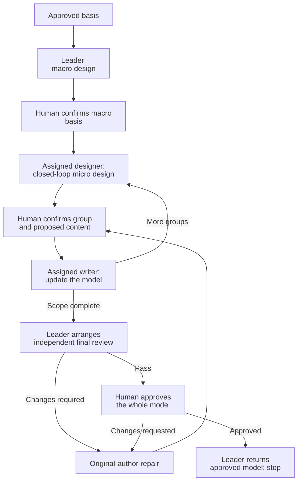

# Clarify Technical Design

Co-design the technical realization with the human, from macro to micro.
Follow [TECHNICAL-MODEL.md](TECHNICAL-MODEL.md) as the authoring and review standard.

## Use by role

Resume at the current step for your assigned role.

### Leader

Lead the whole-scope design and coordination.

1. Establish the basis and confirm the macro direction with the human.
2. Assign ready closed-loop groups, or design them yourself.
3. Integrate confirmed groups using **Update the model**.
4. Run **Final review**, obtain final human approval, then **Return and stop**.

### Closed-loop designer

Make design decisions for your assigned behavior with the human.

1. Establish the group's basis from the assignment and confirmed upstream decisions.
2. Apply **Clarification methods** and **Micro design** within that scope. Use **Macro design** within that scope when needed.
3. Obtain human confirmation. Follow **Update the model** for your assigned files.
4. Return canonical content, confirmation references and cross-group effects to the leader. Remain available for repair.

Stop at this scoped handoff. Local completion does not approve the whole model.
Reading or re-reading this skill does not expand your role or authority.

## Establish the basis

- Read approved requirements, original context and prior decisions/approvals.
- Inspect the relevant repository baseline. Recover missing or stale design context only within the affected scope.
- Use the `artifact-layout` skill for documents produced by this skill: file locations, directory layout and writing boundaries.
- Use the `communication-style` skill for human communication.
- Use the `collaboration-guidance` skill for reusable survey collaborators and decision-conflict escalation.
- Resolve cross-skill resources through registered owners. Reading a standard does not start its workflow.

For heavyweight children:
- Read the approved root requirements and architecture.
- Inherit guarantees, boundary contracts, shared-owner assignments and child dependencies.
- Return global conflicts to the owning authority.
- Update assigned realizations. Return root navigation changes to the root owner.

## Roles and collaboration

Macro and micro are relative to the assigned scope. Keep confirmed upstream decisions as constraints.
Use agent contexts that can perform their communication and writing duties.

### Shared survey collaborators

Survey collaborators explain existing code and documents. They do not make task decisions.
They use `collaboration-guidance` and `communication-style`.

- Share their identities, investigation scopes and contact routes with the team.
- Designers consult them directly. Reuse existing investigations.
- Notify affected members when contacts or scopes change.

### Decision conflicts

Use `collaboration-guidance` for incompatible peer choices or shared questions outside individual scope.
The leader is the parent of its assigned designers.

- Keep unaffected work with its designers.
- Expanding decision scope does not transfer another file's writing responsibility.

## Clarification methods

### Draft-based iteration

Apply this method throughout macro and micro clarification.

- Revise the proposal already presented in chat. Accumulate changes on that draft.
- Re-present the complete revised proposal when appropriate, not only the changes.
- Present the complete final proposal for human confirmation. Write that version into the model after confirmation.

**Example:**

```text
AI：
单任务实现流程如下：

1. 使用 tdd 实现，完成验证。
2. 委派独立子 agent，使用 code-review 评审。
3. 有问题则修复、验证，交回原评审子 agent；重复直到 Pass。
4. 返回完成结果。

用户：
送审前，先把本次改动提交一次 commit。

AI：
在当前方案的“完成验证”和“委派评审”之间加入 commit，其他内容保留。

用户：
每轮评审之后的修复也要提交，方便留痕。

AI：
合并这两次修改，完整方案更新为：

1. 使用 tdd 实现，完成验证。
2. 提交本任务的改动。
3. 委派独立子 agent，使用 code-review 评审。
4. 有问题则修复、验证，提交本轮改动，再交回原评审子 agent；重复直到 Pass。
5. 返回完成结果。

这份完整方案是否可以写入 implement/SKILL.md？

用户：
可以。

AI：
按上面确认的完整版本写入。
```

## Workflow

The diagram shows the leader's whole-stage route.



Module decomposition may lead to multiple macro-to-micro cycles.
Integrate confirmed macro and micro groups as the design progresses.
Reconfirm a changed macro basis before dependent micro design.

## Macro design

The leader clarifies the overall technical direction with the human. Use shared survey collaborators from this stage; begin their preparation once likely investigation scopes are known, following `collaboration-guidance`.

Settle topology, responsibility boundaries and technical direction.

- When code conflicts with established decision documents, prioritize the documented decisions.
- Trace required scenarios through owners, state and core interactions.
- Compare reuse with necessary changes.
- Confirm the macro basis before dependent micro design.

### Macro views

- Use Mermaid topology and sequences to present macro collaboration.
- Add a separate data-flow view when needed for clarity.

## Micro design: closed-loop groups

Turn the confirmed macro design into implementation-ready definitions, contracts and collaboration flows.

A group covers a complete bounded behavior across collaborating owners, definitions, operations and flows.

### Leader: assign the group

Assign groups from the confirmed macro design. Include:

- The closed-loop designer role and behavior boundary.
- Governing decisions and dependencies.
- Relevant peers and shared survey contacts.
- Assigned model files and human contact route.

Explicitly require the designer to read `clarify-technical-design` in full and its `TECHNICAL-MODEL.md` before starting.
Independent groups may progress concurrently when ready.

### Designer: clarify the group

- Use confirmed macro decisions as the technical direction for the group’s micro proposal.
- Clarify changes, data structures, interfaces and exception cases with the human.
- Assess when to present the complete group again. Include topology/sequences, data definitions and interface contracts.
- Consider data definitions and sequences together. Choose the starting point based on the design problem.

**Confirmation unit:** The whole group, not individual fields, types, interfaces or files.
Confirm the group and reconcile affected views before advancing to dependent design.

- Present complete data definitions, including internal types, and interface declarations in fenced code blocks.
- Use Mermaid topology and sequences to explain the group’s collaboration.

## Update the model

Integrate complete confirmed proposals as the design progresses.

### Organize canonical content

Use one `technical.md` for simple scopes.
Use linked `technical/<group>.md` parts when groups need separate writers. Follow `artifact-layout`.
These files form one model. Name parts by design scope, not agent identity.

| Content | Writer |
| --- | --- |
| Global direction and relationships; navigation; complete file-responsibility tree; integrated test plan | Leader |
| Scoped definitions, operations, data/state flows, interactions, exceptions and boundaries | Assigned designer |
| Shared definitions and contracts | Designated file writer |

Define shared contracts once. Other parts reference their canonical location.
Apply `TECHNICAL-MODEL.md` across the complete model.
Local parts supply concrete detail and canonical references, without repeating global sections.

### Write confirmed content

- Assign one writer per file.
- Reconcile changes to other files, then send them to their writers.
- The leader integrates local content without rewriting it or routinely reconfirming unchanged decisions.

- Carry their diagrams, tables, code and essential explanations into the model. Do not replace them with prose summaries.
- Show the exact content and destination in the responsible designer's clarification conversation. Obtain human confirmation before writing.
- Integrate confirmed content into canonical sections. Reconcile affected decisions and references.

Keep unconfirmed proposals in conversation, not candidate files.

If direct human contact is unavailable, the leader relays the complete proposal and the human's reply.
The original designer remains the writer. The relay does not grant approval authority.

## Final review

The leader organizes this whole-model stage; designers remain responsible for their scoped repairs.

- Submit the complete model, including all linked parts, sources and evidence to an independent reviewer using [reviewer-prompt.md](reviewer-prompt.md).
- The original author repairs findings. The same reviewer reassesses.
- Obtain final human approval after Pass.

Ask the original reviewer if feedback is unclear.

The leader coordinates cross-group findings. Changed content still requires human confirmation before writing; the same reviewer reassesses the affected complete model before final approval.

## Return and stop

The leader returns the whole-stage result. Designers return their scoped content and remain available for clarification and repair.

- Return approved model/source references, the review result, human approval and evidence references.
- Heavyweight children return to the root. All scoped realizations must be complete and approved before root-controlled implementation and one delivery.
- Stop before coding. Do not automatically start the next stage.
