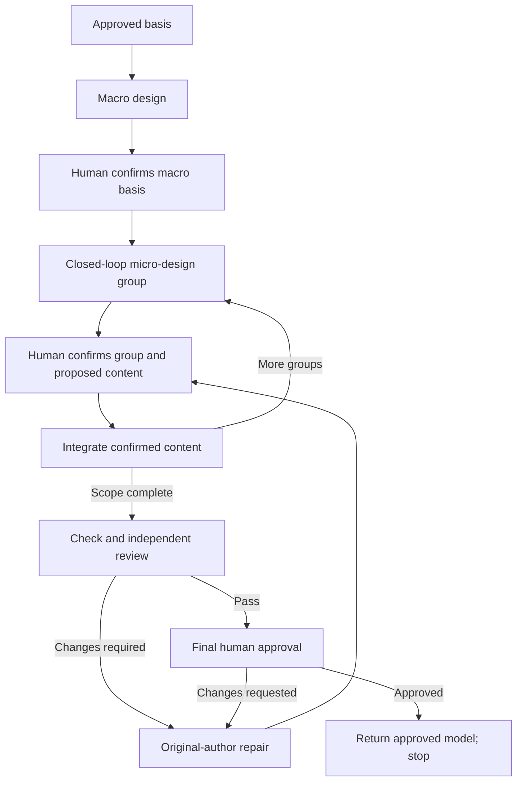

# Clarify Technical Design

Co-design the technical realization with the human, from macro to micro.
Follow [TECHNICAL-MODEL.md](TECHNICAL-MODEL.md) as the authoring and review standard.

## Establish the basis

- Read approved requirements, original context and prior decisions/approvals.
- Inspect the relevant repository baseline.
- Use `artifact-layout` for storage and ownership.
- Use `communication-style` for human communication.
- Resolve cross-skill resources through registered owners. Reading a standard does not start its workflow.

For heavyweight children:
- Read the approved root requirements and architecture.
- Inherit guarantees, boundary contracts, shared-owner assignments and child dependencies.
- Return global conflicts to the owning authority.

## Workflow

Module decomposition may lead to multiple macro-to-micro cycles.
Integrate confirmed macro and micro groups as the design progresses.
Reconfirm a changed macro basis before dependent micro design.

## Macro design

Settle topology, responsibility boundaries and technical direction.

- Trace required scenarios through owners, state and core interactions.
- Compare reuse with necessary changes. Existing code does not override approved intent.
- Confirm the macro basis before dependent micro design.

## Micro design: closed-loop groups

A group covers a complete bounded behavior across collaborating owners, definitions, operations and flows.

- Develop the end-to-end proposal before asking for decisions.
- Work from foundational state and operations toward their consumers.
- Distinguish assumptions from confirmed choices. Clarify blocking human premises first.
- Check normal flows, decisive counterexamples, and consequential interruption/recovery.

Present together in the main response:
- Complete declarations and operation signatures.
- File/owner locations and matching topology/sequences.
- Remaining tradeoffs and precise references to unchanged approved definitions.

**Confirmation unit:** The whole group, not individual types, interfaces or files.
Reconcile affected views before advancing to dependent behavior.

- Complete the scoped file tree and project-grounded macro-flow test plan.
- Heavyweight children inherit global flow references and plan their participation.
- Leave detailed TDD and ordinary implementation choices to implementation.

## Integrate confirmed groups

- Show the exact content or patch and destination in the main response.
- Explain consequences and obtain explicit human confirmation before writing.
- One answer may approve both design and write when both are fully displayed.
- Changed proposals or bases need renewed confirmation.
- Keep unconfirmed proposals in conversation, not candidate files.
- Update canonical sections and affected decisions/references, not amendment diaries.
- Heavyweight children update assigned realizations; root navigation changes go to the root owner.
- Mutually dependent children may share one coordinated review package.

## Check, review and approve

- Check scenario consistency, concrete realization and consequential feasibility against the standard.
- Render every diagram and visually inspect its result.
- Distinguish performed checks from the future test plan.
- Use `review-records` for submission and review/repair evidence.
- Supply [reviewer-prompt.md](reviewer-prompt.md) with the model, sources, confirmations, checks and prior findings.
- Keep the original author and separate original independent reviewer through repairs.
- Repairs follow the write-confirmation rules.
- The same reviewer reassesses the complete current design and prior findings until Pass without unresolved findings or blockers.
- Obtain final human approval of the reviewed design and limits, separate from write consent.
- Human revisions return through the same repair/review loop.

## Return and stop

- Return approved model/source references and review/approval evidence.
- Heavyweight children return to the root. All scoped realizations must be complete and approved before one root ticket set, controller and delivery.
- Stop before ticketing or coding. Do not automatically start the next stage.
