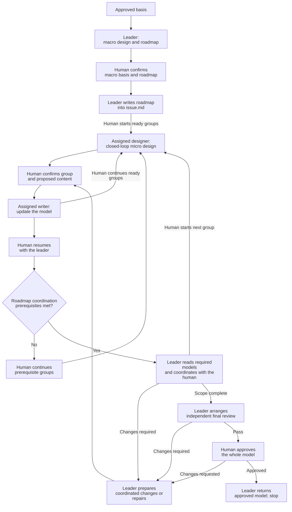

# Clarify Technical Design

Co-design the technical realization with the human, from macro to micro.
Follow [TECHNICAL-MODEL.md](TECHNICAL-MODEL.md) as the authoring and review standard.

## Establish the basis

- Read approved requirements, original context and prior decisions/approvals.
- Read [roles-and-collaboration.md](roles-and-collaboration.md). Identify your role from the current task or assignment and follow its workflow.
- Inspect the relevant repository baseline. Recover missing or stale design context only within the affected scope.
- Use the `artifact-layout` skill for documents produced by this skill: file locations, directory layout and writing boundaries.
- Use the `communication-style` skill for human communication.
- Use the `collaboration-guidance` skill for reusable scouts.
- Resolve cross-skill resources through registered owners. Reading a standard does not start its workflow.

## Clarification methods

### Draft-based iteration

Apply this method throughout macro and micro clarification.

- Revise the proposal already presented in chat. Accumulate changes on that draft.
- Re-present the complete revised proposal when appropriate, not only the changes.
- Present the complete final proposal for human confirmation. Write that version into the model after confirmation.

**Example:**

```text
AI：
单任务实现流程如下：

1. 使用 tdd 实现，完成验证。
2. 委派独立子 agent，使用 code-review 评审。
3. 有问题则修复、验证，交回原评审子 agent；重复直到 Pass。
4. 返回完成结果。

用户：
送审前，先把本次改动提交一次 commit。

AI：
在当前方案的“完成验证”和“委派评审”之间加入 commit，其他内容保留。

用户：
每轮评审之后的修复也要提交，方便留痕。

AI：
合并这两次修改，完整方案更新为：

1. 使用 tdd 实现，完成验证。
2. 提交本任务的改动。
3. 委派独立子 agent，使用 code-review 评审。
4. 有问题则修复、验证，提交本轮改动，再交回原评审子 agent；重复直到 Pass。
5. 返回完成结果。

这份完整方案是否可以写入 implement/SKILL.md？

用户：
可以。

AI：
按上面确认的完整版本写入。
```

## Workflow

The diagram shows the leader's whole-stage route.

For multi-designer work, see the [collaboration example](roles-and-collaboration.md#multi-designer-collaboration).
It shows direct human clarification, human-led progression and dependency-based coordination.



Module decomposition may lead to multiple macro-to-micro cycles.
Integrate confirmed macro and micro groups as the design progresses.
Reconfirm a changed macro basis before dependent micro design.

## Macro design

Clarify the technical direction within your scope with the human.

Use your own scouts from this stage; begin their preparation once likely investigation scopes are known, following `collaboration-guidance`.

Settle topology, responsibility boundaries and technical direction.

- When code conflicts with established decision documents, prioritize the documented decisions.
- Trace required scenarios through owners, state and core interactions.
- Compare reuse with necessary changes.
- Confirm the macro basis before dependent micro design.

### Macro views

- Use Mermaid topology and sequences to present macro collaboration.
- Add a separate data-flow view when needed for clarity.

## Micro design: closed-loop groups

Turn the confirmed macro design into implementation-ready definitions, contracts and collaboration flows.

A group covers a complete bounded behavior across collaborating owners, definitions, operations and flows.

- Use confirmed macro decisions as the technical direction for the group’s micro proposal.
- Clarify changes, data structures, interfaces and exception cases with the human.
- Assess when to present the complete group again. Include topology/sequences, data definitions and interface contracts.
- Consider data definitions and sequences together. Choose the starting point based on the design problem.

**Confirmation unit:** The whole group, not individual fields, types, interfaces or files.
Confirm the group and reconcile affected views before advancing to dependent design.

- Present complete data definitions, including internal types, and interface declarations in fenced code blocks.
- Use Mermaid topology and sequences to explain the group’s collaboration.

## Document organization

Use one `technical.md` for simple scopes.
Use linked `technical/<group>.md` parts when groups need separate writers. Follow `artifact-layout`.
These files form one model. Name parts by design scope, not agent identity.

For a split model, workspace file responsibilities are:

| File | Responsibility | References |
| --- | --- | --- |
| `issue.md` | Work definition, navigation and the confirmed Design Alignment Roadmap | Link design groups to their model files. |
| `technical.md` | Global direction, boundaries and cross-group relationships; navigation; complete file-responsibility tree; overall integration test plan | Reference group contracts to explain whole-model behavior. |
| `technical/<group>.md` | Complete scoped design: definitions, operations, data/state flows, interactions, exceptions and boundaries; internal test plan | Reference global constraints and contracts owned by other parts. |

Place shared definitions and contracts in the file responsible for that design.

Define shared contracts once. Other parts reference their canonical location.
Apply `TECHNICAL-MODEL.md` across the complete model.
Local parts supply concrete detail and canonical references, without repeating global sections.

## Update the model

Integrate complete confirmed proposals as the design progresses.

- Show the exact content and destination in the current writer's conversation with the human. Obtain human confirmation before writing.
- Carry their diagrams, tables, code and essential explanations into the model. Do not replace them with prose summaries.
- Integrate confirmed content into canonical sections. Reconcile affected decisions and references.
- Preserve unaffected confirmed content without routinely reconfirming unchanged decisions.

Keep unconfirmed proposals in conversation, not candidate files.

## Final review

The leader organizes this whole-model stage and repairs findings across the complete model.

- Submit the complete model, including all linked parts, sources and evidence to an independent reviewer using [reviewer-prompt.md](reviewer-prompt.md).
- The same reviewer reassesses after repairs.
- Obtain final human approval after Pass.

Ask the original reviewer if feedback is unclear.

Changed content still requires human confirmation before writing.
The same reviewer reassesses the affected complete model before final approval.

## Return and stop

The leader returns the whole-stage result.

- Return approved model/source references, the review result, human approval and evidence references.
- Stop before coding. Do not automatically start the next stage.
