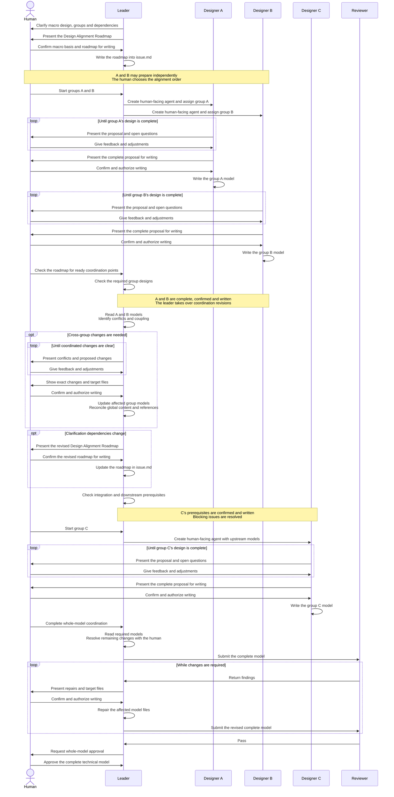

# Multi-designer Collaboration

This example has two independent groups, A and B.
Group C depends on their confirmed designs.
The roadmap marks a coordination point requiring both A and B before group C starts.

The leader develops the Design Alignment Roadmap with the human and records it in `issue.md`.
Each designer is a separate AI agent with its own human-facing conversation.
Each designer clarifies directly with the human and writes confirmed content.
The human chooses the alignment order and initiates coordination.
The leader then reads and revises the affected models directly with the human.

Designers do not report completion to the leader.
The human initiates coordination; the leader revises affected models after confirmation.
Scouts remain available to their creators for factual consultation throughout the process.
