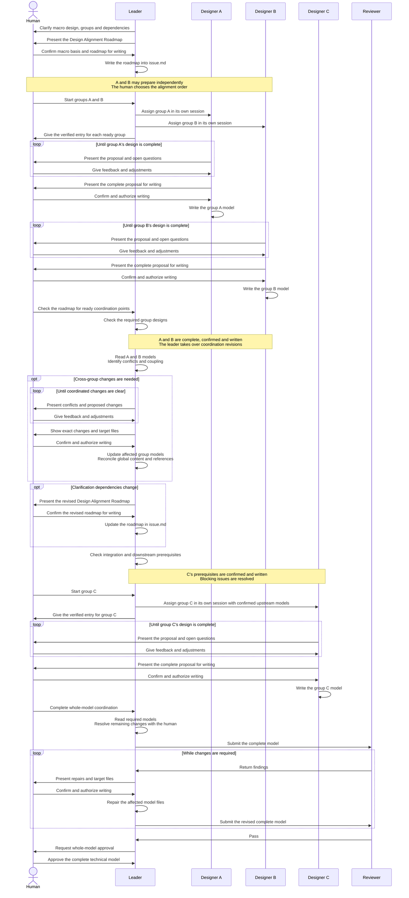

# Roles and collaboration

Identify your role from the current task or assignment.
Follow the corresponding workflow and resume at its current step.
Reading this skill does not expand your role or authority.

Macro and micro are relative to the assigned scope.
Keep confirmed upstream decisions as constraints.

## Leader

The human initiates cross-group coordination and progression.
For a split model, the leader writes `issue.md` and `technical.md`.

1. **Plan with the human.**
   Apply progressive modeling within the leader's scope to establish the macro direction.
   Divide the scope into closed-loop design groups.
   Plan integration testing for the overall design.

   Create a **Design Alignment Roadmap**: a dependency graph of these groups.
   Edges point from prerequisite groups to dependent groups.
   Each dependency identifies the upstream design needed by the downstream group.
   Mark coordination points and the group designs required at each point.

   Confirm the macro direction and roadmap with the human.
   Write the confirmed roadmap into the workspace's `issue.md`.

2. **Assign groups along the roadmap.**
   At the human's request, design a ready group in the current session or assign it to a designer.
   Follow the roadmap in `issue.md`.
   Independent groups may progress concurrently.
   Start dependent groups from confirmed upstream models, after resolving their blockers.

   When assigning a group to a designer, load and follow the registered `start-designer-session`
   skill in the leader's session. Use the [designer session contract](#designer-session-contract)
   to hand over the assignment and tell the human where to enter the live session.
   Disable automatic notifications from designers to the leader.

   Each assignment includes:
   - The designer role, behavior boundary and assigned files.
   - Governing decisions, roadmap dependencies and confirmed upstream models.

   Give the designer write access to its assigned files.
   Require reading `clarify-technical-design` in full, the registered `progressive-modeling` skill and `TECHNICAL-MODEL.md` before starting.

3. **Coordinate along the roadmap.**
   At the human's request, check which coordination points are ready.
   Use the Design Alignment Roadmap to identify the required group designs.
   Once those designs are complete, confirmed and written, read them together.
   Clarify their conflicts and coupling directly with the human.

   Take over revisions to the affected model files.
   Those designers stop writing them.
   Follow **[Write confirmed model content](SKILL.md#write-confirmed-model-content)** without routing changes back through designers.

   Identify which downstream groups are ready for further alignment.
   If dependencies change, confirm the revised roadmap with the human and update `issue.md`.

4. **Complete the whole-model review.**
   Run **[Final review](SKILL.md#final-review)**, obtain final human approval, then **[Return and stop](SKILL.md#return-and-stop)**.

## Designer session contract

`start-designer-session` is the user's implementation of this handoff for their harness.
The leader supplies the group name, workspace and assignment described above. The skill
starts the designer with that assignment; it does not choose groups or make design decisions.

Before reporting a group ready, verify that its designer received the assignment in the
intended workspace and that the human's configured client offers a writable entry to that
same live session. The designer stays online after the launch returns, while waiting for
the human, and while the human works with another group. The human can return and reply
without relaunching the designer or going through the leader.

Return the group name and where to enter it from the human's client. If the skill is
unavailable or the handoff fails, report the blocker for that group: distinguish a session
that never started from one that started but cannot be reached or verified. Do not present
a saved conversation, a read-only view or messages relayed by the leader as a live handoff.

## Closed-loop designer

Make design decisions for your assigned behavior directly with the human.
Write your assigned files during local clarification.

1. Establish the group's basis from the assignment and confirmed upstream decisions.
2. Apply progressive modeling within the group's assigned scope. Establish its working macro model before elaborating dependent micro design; inherit confirmed upstream decisions without reopening them.
   Apply [Clarification methods](SKILL.md#clarification-methods) and [Micro design](SKILL.md#micro-design) within that scope. Plan internal tests for the group.
3. Obtain human confirmation. Follow **[Write confirmed model content](SKILL.md#write-confirmed-model-content)** for the assigned files.

Keep tentative design choices within the group's clarification.
The human initiates coordination with the leader after local completion.
No completion report to the leader is required.
Local completion does not approve the whole model.

## Scouts

Scouts explain existing code and documents. They do not make task decisions.
They use `collaboration-guidance`.

The leader and each designer create and reuse their own scouts.

## Multi-designer Collaboration

This example has two independent groups, A and B.
Group C depends on their confirmed designs.
The roadmap marks a coordination point requiring both A and B before group C starts.

The leader develops the Design Alignment Roadmap with the human and records it in `issue.md`.
Each assigned group has its own human-facing session.
Each designer clarifies directly with the human and writes confirmed content.
The human chooses the alignment order and initiates coordination.
The leader then reads and revises the affected models directly with the human.

Designers do not report completion to the leader.
The human initiates coordination; the leader revises affected models after confirmation.
Scouts remain available to their creators for factual consultation throughout the process.
