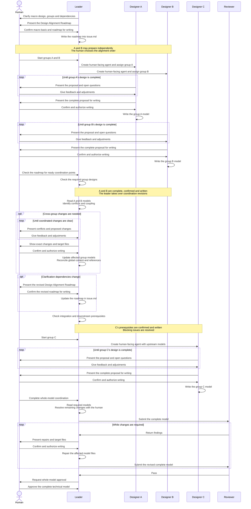

# Roles and collaboration

Identify your role from the current task or assignment.
Follow the corresponding workflow and resume at its current step.
Reading this skill does not expand your role or authority.

Macro and micro are relative to the assigned scope.
Keep confirmed upstream decisions as constraints.

## Leader

The human initiates cross-group coordination and progression.
For a split model, the leader writes `issue.md` and `technical.md`.

1. **Plan with the human.**
   Establish the basis and clarify the macro direction.
   Divide the scope into closed-loop design groups.
   Plan integration testing for the overall design.

   Create a **Design Alignment Roadmap**: a dependency graph of these groups.
   Edges point from prerequisite groups to dependent groups.
   Each dependency identifies the upstream design needed by the downstream group.
   Mark coordination points and the group designs required at each point.

   Confirm the macro direction and roadmap with the human.
   Write the confirmed roadmap into the workspace's `issue.md`.

2. **Assign groups along the roadmap.**
   At the human's request, assign ready groups or design them yourself.
   Follow the roadmap in `issue.md`.
   Independent groups may progress concurrently.
   Start dependent groups from confirmed upstream models, after resolving their blockers.

   Create each closed-loop designer as a separate AI agent with its own human-facing conversation.
   The human must be able to open that conversation and talk to the agent directly.
   Disable automatic notifications from designers to the leader.

   Each assignment includes:
   - The designer role, behavior boundary and assigned files.
   - Governing decisions, roadmap dependencies and confirmed upstream models.

   Give the designer write access to its assigned files.
   Require reading `clarify-technical-design` in full and its `TECHNICAL-MODEL.md` before starting.

3. **Coordinate along the roadmap.**
   At the human's request, check which coordination points are ready.
   Use the Design Alignment Roadmap to identify the required group designs.
   Once those designs are complete, confirmed and written, read them together.
   Clarify their conflicts and coupling directly with the human.

   Take over revisions to the affected model files.
   Those designers stop writing them.
   Follow **[Update the model](SKILL.md#update-the-model)** without routing changes back through designers.

   Identify which downstream groups are ready for further alignment.
   If dependencies change, confirm the revised roadmap with the human and update `issue.md`.

4. **Complete the whole-model review.**
   Run **[Final review](SKILL.md#final-review)**, obtain final human approval, then **[Return and stop](SKILL.md#return-and-stop)**.

## Closed-loop designer

A closed-loop designer is a human-facing AI agent.
Make design decisions for your assigned behavior directly with the human.
Write your assigned files during local clarification.

1. Establish the group's basis from the assignment and confirmed upstream decisions.
2. Apply **[Clarification methods](SKILL.md#clarification-methods)** and **[Micro design](SKILL.md#micro-design-closed-loop-groups)** within that scope. Use **[Macro design](SKILL.md#macro-design)** within that scope when needed.
   Plan internal tests for the group.
3. Obtain human confirmation. Follow **[Update the model](SKILL.md#update-the-model)** for your assigned files.

Keep tentative design choices within the group's clarification.
The human initiates coordination with the leader after local completion.
No completion report to the leader is required.
Local completion does not approve the whole model.

## Scouts

Scouts explain existing code and documents. They do not make task decisions.
They use `collaboration-guidance` and `communication-style`.

The leader and each designer create and reuse their own scouts.

## Multi-designer Collaboration

This example has two independent groups, A and B.
Group C depends on their confirmed designs.
The roadmap marks a coordination point requiring both A and B before group C starts.

The leader develops the Design Alignment Roadmap with the human and records it in `issue.md`.
Each designer is a separate AI agent with its own human-facing conversation.
Each designer clarifies directly with the human and writes confirmed content.
The human chooses the alignment order and initiates coordination.
The leader then reads and revises the affected models directly with the human.

Designers do not report completion to the leader.
The human initiates coordination; the leader revises affected models after confirmation.
Scouts remain available to their creators for factual consultation throughout the process.
