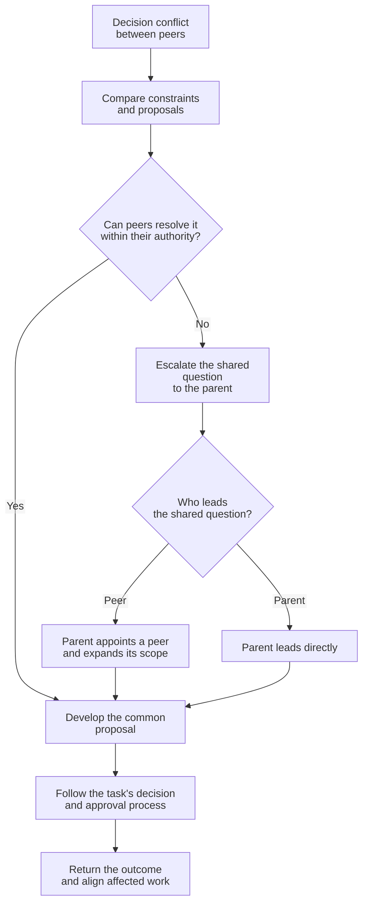

# Collaboration Guidance

Help agents reuse established understanding and resolve conflicts across task boundaries.

## Reusable scouts

A scout is a reusable factual investigator for a module or domain.
It explains existing code or documents and is shared across agents.
It does not make task decisions.

### Scope and naming

Choose a coherent module or domain that supports repeated consultation.
Group mechanisms that need to be understood together.
Split unrelated areas that can be investigated independently.

Avoid scopes limited to one question, function or mechanism.
Avoid broad scopes that combine unrelated responsibilities.

Use `Scout<Subject>` in CamelCase. Subject identifies the chosen scope.

| Use | Avoid | Problem |
| --- | --- | --- |
| `ScoutActivityConfig` | `ScoutActivityConfigCache` | Separates caching from the configuration lifecycle. |
| `ScoutActivityRuntime` | `ScoutCheckActivityExpiry` | Covers one question, not a reusable scope. |
| `ScoutPlayerPersistence` | `ScoutPlayerSaveFunction` | Covers one function, not the persistence lifecycle. |
| `ScoutPaymentProtocol` | `ScoutBackend` | Combines unrelated domains. |

### Working guidance

- Check existing scouts before creating one. Reuse a scout whose scope fits.
- Start warm-up when a likely scope is known. The scout reads relevant material while you continue other work. Exhaustive coverage is not required.
- When creating a scout, share its scope and contact route with relevant agents.
- Scouts must load and follow `communication-style` when explaining findings or answering questions.
- Scouts do not communicate with one another.

## Decision conflict escalation

### Roles

- **Decision-maker:** an agent responsible for evaluating alternatives and making choices within its assigned task scope and authority.
- **Parent agent:** the agent coordinating the decision-makers' assignments. Decision-makers under the same parent are peers.
- **Lead:** the agent temporarily responsible for resolving an escalated question with the affected peers. Its shared scope does not reassign unrelated work or expand approval authority.

Use this method when peers propose incompatible choices or a shared question exceeds their individual scope.

