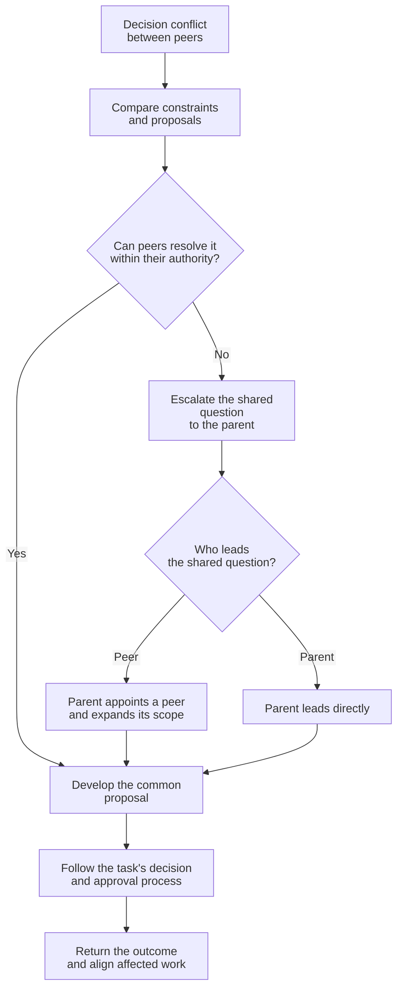

# Collaboration Guidance

Help agents reuse established understanding and resolve conflicts across task boundaries.

## Reusable survey collaborators

A survey collaborator is an agent that retains context about existing
code or documents for repeated consultation. It does not make task decisions.

Name it for its investigation scope rather than the current question or action:
`ActivityConfigCacheSurvey`, not `CheckActivityConfigCacheReload`.
Avoid a broader name such as `CacheSurvey` when only that specific cache is in scope.

Once a likely investigation scope is known, let its collaborator familiarize
itself with relevant code or documents while the coordinating agent continues
the task, rather than waiting for a specific question. Build useful factual
context without requiring an exhaustive survey.

Use the `communication-style` skill to explain findings and answer questions.

Make its scope and contact route known to relevant agents. Direct follow-up
questions to the same collaborator rather than restarting the investigation.
When its findings change, it informs the affected agents.

## Decision conflict escalation

### Roles

- **Decision-maker:** an agent responsible for evaluating alternatives and making choices within its assigned task scope and authority.
- **Parent agent:** the agent coordinating the decision-makers' assignments. Decision-makers under the same parent are peers.
- **Lead:** the agent temporarily responsible for resolving an escalated question with the affected peers. Its shared scope does not reassign unrelated work or expand approval authority.

Use this method when peers propose incompatible choices or a shared question exceeds their individual scope.

