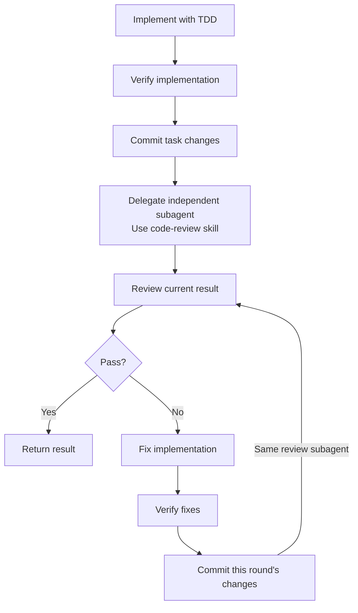

# Implement

Read the assigned requirements, design and relevant code.

Use `tdd` in the current context to implement the work.
Follow repository conventions.
Complete affected callers, tests and documentation.

Apply engineering judgment within the intended behavior and design.
Resolve ordinary implementation details independently.
Discuss consequential changes to behavior, contracts or architecture.

Run relevant project checks and the full test suite.
Exercise the actual changed behavior.
Report actual results and material limits.

Complete implementation and verification.
Commit only this task's changes before the first review.

Delegate review to an independent subagent.
Have the subagent use the `code-review` skill.

If issues are found:
- Fix the implementation.
- Verify the fixes.
- Commit only this round's changes.
- Resubmit the new commit to the same review subagent.

Repeat the repair–verification–review loop until Pass.
Return the completed result to the caller.
