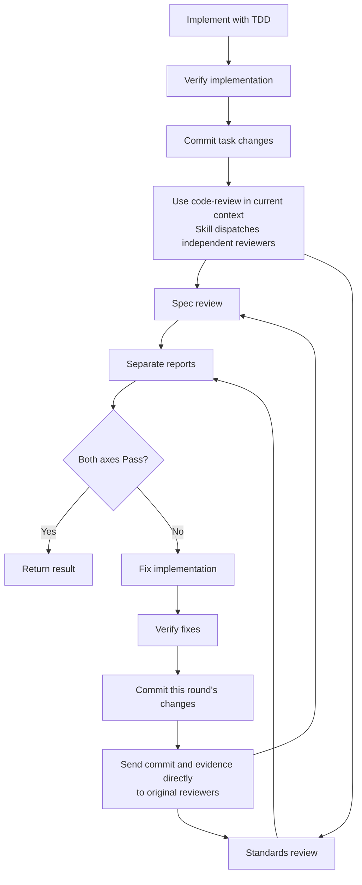

# Implement

Read the assigned requirements, design and relevant code.

Use `tdd` in the current context to implement the work.
Follow repository conventions.
Complete affected callers, tests and documentation.

Apply engineering judgment within the intended behavior and design.
Resolve ordinary implementation details independently.
Discuss consequential changes to behavior, contracts or architecture.

Run relevant project checks and the full test suite.
Exercise the actual changed behavior.
Report actual results and material limits.

Complete implementation and verification.
Commit only this task's changes before the first review.

Use the code-review skill in the current context.
If a review report is unclear, ask the original reviewer for clarification.

If issues are found:
- Fix the implementation.
- Verify the fixes.
- Commit only this round's changes.
- Send the new commit and verification evidence back to the same reviewers through their supported conversation channels.

Repeat the repair–verification–review loop until both axes Pass.
Return the completed result to the caller.
