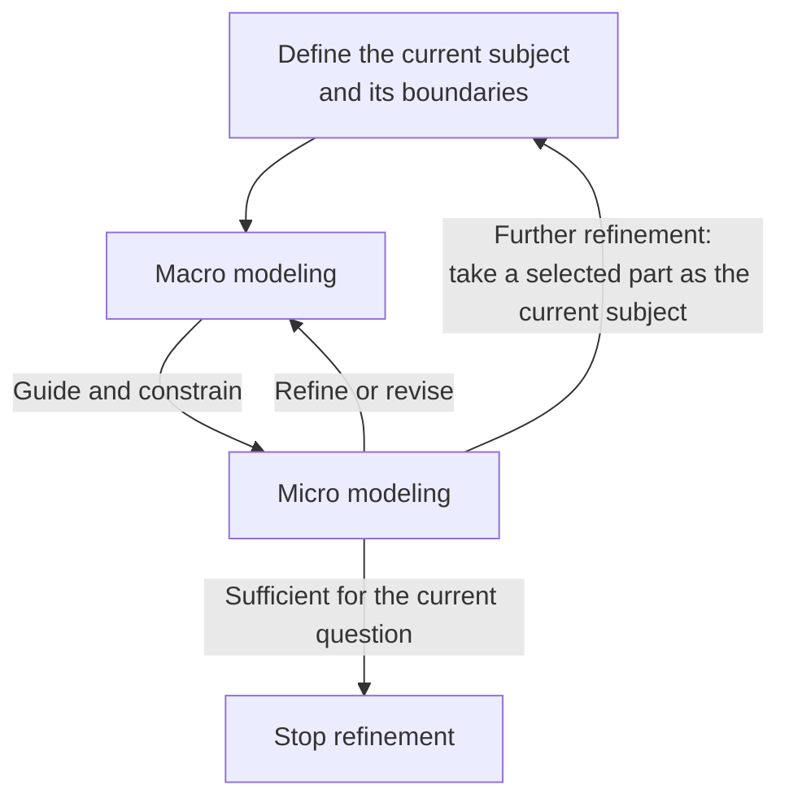

# Progressive Modeling

Within clear boundaries, let the whole guide analysis of its parts. Use insights from the parts to revise the whole, progressively building an understanding of the problem.

## Frame the current subject and its boundaries

Identify what you are examining and which question you need to answer.

Carry established understanding into each refinement; do not treat a narrower subject as an unrelated problem.

Let the current question guide the subject’s boundaries. Preserve relevant relationships across those boundaries.

## Understand macro and micro as relative levels

**Macro modeling** establishes the current subject’s overall structure, key relationships and core behavior.

**Micro modeling** elaborates selected parts under that macro model, making their internal structure, behavior and mechanisms concrete.

Macro and micro are not fixed sizes, roles or technical levels. A part is local relative to its enclosing model. When examined further, that part becomes the current subject and has its own macro and micro models.

Narrowing the subject does not mean its macro model is already established.

## Let macro modeling guide micro modeling

Form a working macro model sufficient to guide further analysis.

Select parts for micro modeling according to the current question. Preserve each part’s relationship to the enclosing macro model.

The macro model may be preliminary. It should still provide sufficient context for micro modeling.

## Use micro modeling to revise macro modeling

During micro modeling, continually examine whether local findings support the macro model.

When local findings require a model change, revise the model at the relevant level and re-examine dependent micro models.

## Deepen according to the question

Deepen the model as needed to answer the current question or support the required decision. Do not pursue exhaustive decomposition.

## Maintain model coherence

Use Mermaid diagrams where they help clarify the model. Combine them with text or other representations as needed.

Keep representations across levels connected and consistent. The macro model should explain the concrete situations under analysis.
