# Test-Driven Development

Read [TESTING.md](TESTING.md) before constructing tests. Work in the current implementer context; behavior selection and coding belong to the same loop.

## Overview

Write the test first. Observe the intended failure. Implement the behavior.
Refactor while keeping tests green.

Work from the agreed design and apply engineering judgment.
Resolve ordinary gaps autonomously; discuss consequential design changes
with the human.

## When to Use

Use TDD for new features, bug fixes and behavior changes.

For refactoring:
- Assess whether new tests are needed.
- Keep, adapt, replace or remove existing tests based on their relevance.
- Preserve coverage of behavior that must remain unchanged.

When automated TDD is impractical, explain the limitation and exercise
the behavior through an appropriate direct scenario.

## Core Principle

Tests must verify intended behavior and contracts, not accommodate
the current implementation.

- Derive expected outcomes from requirements and contracts.
- Do not reproduce implementation logic to calculate expected results.
- Do not change expectations merely to make the current code pass.

## Red–Green–Refactor

```mermaid
flowchart TD
    Red["RED<br/>编写或复用行为测试"] --> CheckRed{"运行测试，理解结果"}
    CheckRed -->|"失败暴露目标行为缺口"| Green["GREEN<br/>实现当前行为"]
    CheckRed -->|"测试或环境有问题"| Red
    CheckRed -->|"目标行为已被有效覆盖"| Next{"检查剩余范围"}
    Green --> CheckGreen{"运行测试与相关回归<br/>是否通过？"}
    CheckGreen -->|"未通过：依据契约诊断并修正"| Green
    CheckGreen -->|"通过，需要整理"| Refactor["REFACTOR<br/>整理实现，不改变行为"]
    Refactor --> CheckGreen
    CheckGreen -->|"通过，无需继续整理"| Next
    Next -->|"还有未完成行为"| Red
    Next -->|"范围已完成"| Done["完成当前范围"]
```



### RED — Write a Behavior Test

Write or reuse a test that expresses the next behavior.

- Focus on one behavior through its public interface.
- Name the test after the expected behavior.
- Exercise real code; substitute dependencies only when necessary.

**Good — 验证实际重试行为和结果：**

```typescript
test('succeeds on the third attempt after two failures', async () => {
  let attempts = 0;

  const result = await retryOperation(async () => {
    attempts++;
    if (attempts < 3) throw new Error('temporary failure');
    return 'success';
  });

  expect(result).toBe('success');
  expect(attempts).toBe(3);
});
```

**Bad — 只检查实现中的常量：**

```typescript
test('retry limit is 3', () => {
  expect(MAX_ATTEMPTS).toBe(3);
});
```

这个反例只确认了常量的值，没有验证重试是否真的发生、何时停止、最终返回什么。

使用 mock 本身不等于测试无效，关键是断言是否验证了目标行为。

一个行为可以需要多个断言，不等于只能写一个 `expect`。上面的成功结果和尝试次数，共同描述了这一项重试行为。

### Verify RED — Understand the Result

Run the focused test with the project's test runner and inspect the result.

- Expected failure: confirm it exposes the intended behavior gap.
- Unexpected failure: diagnose the cause and correct test or environment errors.
- Pass: assess coverage. Keep a valid test; correct a test that misses
  the intended behavior.

Reuse applicable failure evidence instead of rerunning solely to confirm
an already observed failure.

### GREEN — Minimal Code

Write the simplest production code that implements the current behavior
and makes its test pass.

**Good — 完整实现最多三次尝试：**

```typescript
async function retryOperation<T>(
  operation: () => Promise<T>
): Promise<T> {
  for (let attempt = 0; attempt < 3; attempt++) {
    try {
      return await operation();
    } catch (error) {
      if (attempt === 2) throw error;
    }
  }
  throw new Error('unreachable');
}
```

成功时返回结果；尝试耗尽时抛出最后的错误。这里写的是实际被测试、被调用的实现。

**Avoid — 尚未需要就扩展配置、策略和回调：**

```typescript
declare function retryOperation<T>(
  operation: () => Promise<T>,
  options?: {
    maxAttempts?: number;
    backoff?: 'linear' | 'exponential';
    onRetry?: (attempt: number) => void;
  }
): Promise<T>;
```

Do not add speculative features or make unrelated changes.

这里的“最小”是**不做无依据的扩张**，不是省略必要实现。反例的前提也是这些能力尚未被需要；如果需求已经要求，就不属于过度设计。

### Verify GREEN — Check the Result

Run the behavior test and relevant regressions.

- Confirm both the behavior test and relevant regressions pass.
- Diagnose failures against the contract and fix regressions introduced
  by the change.
- Inspect errors and warnings; distinguish new problems from pre-existing ones.

Before completing the change, run the project's full test suite.
Report actual results and all observed unresolved failures.

### REFACTOR — Clean Up

After tests pass, make useful improvements:
- Remove duplication.
- Improve names.
- Extract helpers where they simplify the code.

Preserve behavior and rerun affected tests.
Do not add new behavior in this step.

Skip refactoring when there is nothing useful to improve.

### Repeat

Review the remaining scope and behavior coverage.
Choose the next behavior that needs implementation or verification.
Repeat until the assigned scope is complete.

## Good Tests

| Quality | Good | Bad |
| --- | --- | --- |
| Focused | One behavior, with the assertions needed to establish it | Unrelated behaviors bundled together |
| Clear | Name describes the expected behavior | Names such as `test1` or `works` |
| Shows intent | Demonstrates how the interface is used and what it guarantees | Obscures what the code should do |

When writing or changing tests, read [writing-good-tests.md](writing-good-tests.md):
- Identify a realistic production defect the test should catch.
- Assert on real behavior, not the presence of a mock.
- Keep test-only helpers out of production APIs.
- Understand relevant dependency side effects before substituting them.

## When Stuck

| Problem | Suggestions |
| --- | --- |
| Unsure how to test | Start with the expected outcome and assertion, using the intended public interface. Clarify missing behavior when needed. |
| Test too complicated | Review the test boundary and setup; consider simplifying the interface. |
| Everything needs mocking | Check dependency boundaries and coupling; consider real collaborators or dependency injection. |
| Test setup too large | Reuse fixtures or extract test helpers. If setup remains complex, revisit the interface and dependencies. |
